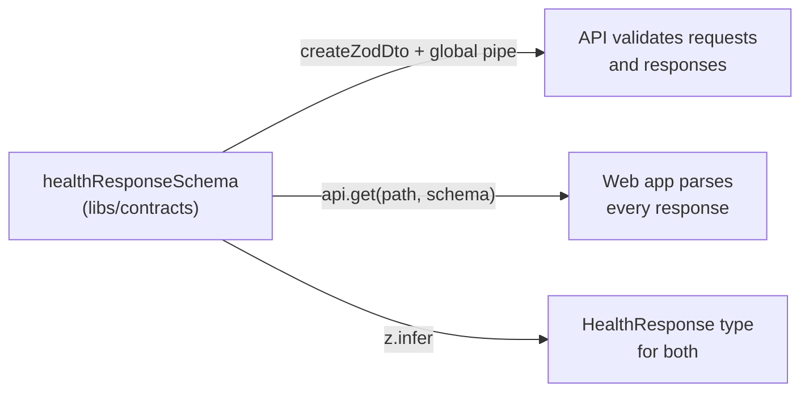

**Status:** Accepted · **Issue:** [#6](https://github.com/nitzanto/ratewatch/issues/6)

The API and dashboard exchange request bodies, responses and, soon, realtime events. Every one of those shapes is **one Zod schema in `libs/contracts`**, exporting its inferred TypeScript type, and validated at runtime on both sides.

**Options considered**

- **Shared Zod schemas** (chosen): one definition gives compile-time types and runtime validation, for HTTP and WebSocket events alike.
- **TypeScript types only**: no runtime cost, but no runtime validation either, so types and reality can drift.
- **OpenAPI-first with generated clients**: a spec edit and a codegen step for every change, and WebSocket events sit outside OpenAPI.
- **NestJS DTO classes with `class-validator`**: decorators tie the shapes to Nest, so the web app can't share them.
- **tRPC**: end-to-end types, but it replaces REST and NestJS WebSockets with its own transport.

|                  | Zod schemas                                 | Types only                        | OpenAPI + codegen                    | Nest DTOs                           | tRPC                                      |
| ---------------- | ------------------------------------------- | --------------------------------- | ------------------------------------ | ----------------------------------- | ----------------------------------------- |
| Reliability      | Strong: a breaking change fails both builds | Fair: types and reality can drift | Strong, once codegen runs            | Fair: the web app can't share them  | Strong                                    |
| Security         | Strong: runtime validation on both sides    | Weak: no runtime validation       | Good: server-side validation         | Good: server-side only              | Good                                      |
| Maintainability  | Strong: one file per shape, no codegen      | Strong                            | Fair: spec edits plus a codegen step | Fair: decorators tie shapes to Nest | Fair: replaces REST and NestJS WebSockets |
| WebSocket events | Covered                                     | Types only                        | Not covered                          | Partly                              | Own transport only                        |

**Why:** it's the only option with runtime validation on both sides from one definition that also covers WebSocket events, without a codegen step or a new transport. A breaking shape change fails the build of both apps in the same pull request.

**Trade-offs we accept:** Zod is a runtime dependency of both apps. There's no OpenAPI document for external consumers.

**Revisit when:** external consumers need an OpenAPI document; generate it from the schemas.

**In the code:** the schemas are in `libs/contracts/src/lib/`, one resource per file, named by what the file holds: `click.schema.ts` and `rate-limit.schema.ts` for schemas and their types (response headers a client reads included: `rateLimitHeadersSchema` parses `x-count`), `rate-limit.constants.ts` for values both apps must agree on, such as the `x-count` header name, the default limit of 100 and the 90% warning threshold. The library holds no business logic, and a lint rule stops the library importing from either app. The API validates through `nestjs-zod` (see the [request pipeline](../../architecture/backend/#request-pipeline)); the web app parses every response in its API client, `apps/web/src/libs/api/api-client.ts`.
