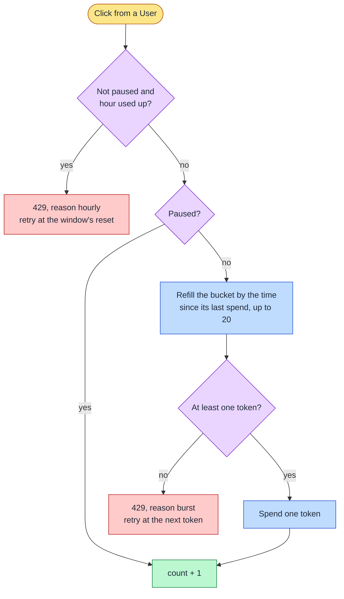

**Status:** Accepted · **Date:** 2026-11-01 · **Issue:** [#79](https://github.com/nitzanto/ratewatch/issues/79)

## Context and problem statement

The hourly window counts every request until the limit, however fast they arrive. A buggy client or a script can send 100 requests in one second, and the user is then refused for the rest of the hour. How can the limiter stop a burst without changing the hourly limit everything else is built on: the reset time, extra requests in the current window, the statuses and the analytics?

## Decision drivers

- **Keep the hourly contract:** 100 requests per hour, a count that resets every hour, `x-count` with the requests left, and a 429 with the time to try again.
- **Correctness under concurrency:** no request slips past either limit.
- **A usable product:** a person clicking quickly is never refused, and can still reach the hourly limit in the clicker.
- **Performance:** no extra Redis call per request.

## Considered options

1. **A token bucket on top of the hourly window**
2. Replace the hourly window with a token bucket
3. A second fixed window, such as 10 per minute
4. A slow token bucket on top of the window, refilled at the hourly rate (one token every 36 seconds)

## Trade-off matrix

|                   | Bucket on the window (20, +5/s)       | Bucket instead of the window                         | Second fixed window                     | Slow bucket on the window           |
| ----------------- | ------------------------------------- | ---------------------------------------------------- | --------------------------------------- | ----------------------------------- |
| Hourly contract   | Strong: unchanged                     | Weak: no reset time or current window                | Strong                                  | Strong                              |
| Stops bursts      | Good: 100 at once spend 20            | Good                                                 | Fair: 20 in two seconds across an edge  | Strong: 100 at once spend 10        |
| A person clicking | Strong: about 20 s to reach the limit | Weak: strict 100 per hour means a few clicks a burst | Fair: refused after 10 in a minute      | Weak: refused after 10 quick clicks |
| Performance       | Strong: the same one script           | Strong                                               | Strong: one more key in the same script | Strong                              |
| Maintainability   | Good: two fields in the window's hash | Weak: admin controls and dashboard redefined         | Good                                    | Good                                |

## Decision outcome

Chosen option: **a token bucket on top of the hourly window**, holding 20 tokens and refilled at 5 per second. The hourly window still decides how many requests a user gets each hour; the bucket only decides how fast they can arrive. Five per second is above how fast a person clicks for long and far below a script.

For example, a client sends 100 requests at once at 12:00:00. Twenty go through and 80 get a burst 429 with a retry time 200 ms later; the user has 80 requests left this hour, not 0. A person clicking three times a second is never refused by the bucket, and reaches the hourly limit after about 30 seconds of clicking.

- The bucket lives in the window's hash, as `tokens` and `tokensAt`, so it needs no new key: a new window and an admin reset both start with a full bucket.
- Each API instance passes its own time to the script. The time since the last spend is never taken as negative, so an instance whose clock is behind can't drain the bucket.
- A burst refusal writes nothing, like an hourly one, so it never uses up either limit.
- A burst refusal counts toward the 429s today on the dashboard, but never sends `rate:limit_exceeded`: the user still has requests this hour, and their status stays as it was.
- A paused user skips the bucket too: a pause suspends throttling.
- The 429 body says which limit refused it with `reason`. The clicker shows "Slow down" for a burst and keeps the count, and shows the wait screen only for the hourly limit.

### Consequences

- Good, because a burst can spend at most 20 of the hour's requests, and the user is told to wait a fraction of a second, not an hour.
- Good, because everything built on the hourly window keeps working unchanged.
- Bad, because a person who deliberately clicks 100 times in about 20 seconds still uses up their hour; the bucket can't tell that from intent.
- Bad, because clocks that drift between API instances shift the refill slightly.

### Confirmation

- Tests over HTTP with a mock Redis: 21 clicks at once let 20 through; a refusal doesn't lower `x-count`; a token comes back every 200 ms; a paused user is never burst-limited.
- A test against a real Redis: 150 simultaneous clicks let exactly 20 through.
- A web component test: a burst 429 shows "Slow down", keeps the count and keeps clicking on.

## Notes on options

- **Replacing the window with a token bucket** has no reset time, no current window to add extra requests to, and no count per window for the top users. To keep 100 per hour strict, its capacity plus an hour's refill must stay at or under 100, so the clicker would refuse a person after a few quick clicks.
- **A second fixed window** allows a full minute's requests at the end of one minute and again at the start of the next, and refuses a person after 10 clicks in a minute.
- **A slow bucket** also protects a person from their own mistakes, but refuses them after 10 quick clicks, so the clicker could no longer reach the hourly limit.

## In the code

- `apps/api/src/app/rate-limit/constants/rate-limit.constants.ts`: the script, with both limits, and `defaultBurstLimit`.
- `apps/api/src/app/rate-limit/interceptors/rate-limit.interceptor.ts`: the two 429s and what it hands the dashboard.
- `libs/contracts/src/lib/rate-limit.schema.ts`: the 429 body's `reason`.
- `apps/web/src/features/cookie-clicker/`: the "Slow down" note.
