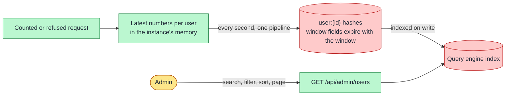

**Status:** Accepted · **Date:** 2026-10-31 · **Issue:** [#45](https://github.com/nitzanto/ratewatch/issues/45)

## Context and problem statement

The dashboard lists users with their requests left, reset time, status and last request. Admins search by user ID, filter by status and last active time, sort by any column, and see a count for each status, the top users and the refused requests today. It must work with tens of users today and very many later, without slowing the limit check. Where does this data live, how is it written, and how is it queried and paged?

## Decision drivers

- **Performance:** the limit check stays one Redis call; dashboard writes stay off the request path.
- **Scalability:** the first load and each query stay small however many users there are.
- **Correctness:** a window that ended never shows a stale status.
- **Maintainability:** no index code of our own to keep in step with the data.

## Considered options

1. **User records in Redis 8, indexed by its query engine, written once per second**
2. Sorted sets maintained by hand
3. Load all users into the browser
4. A database for the dashboard
5. Valkey with `valkey-search`

## Trade-off matrix

|                 | Redis 8 query engine                                     | Hand-made sorted sets                           | All users in the browser             | A database                  | Valkey + valkey-search         |
| --------------- | -------------------------------------------------------- | ----------------------------------------------- | ------------------------------------ | --------------------------- | ------------------------------ |
| Scalability     | Strong: indexed per shard                                | Weak: each index is one global hot key          | Weak: first load grows with users    | Good                        | Strong                         |
| Performance     | Good: each batch re-indexes the users it writes          | Good                                            | Strong once loaded                   | Fair: another network hop   | Good                           |
| Reliability     | Good: data lives 24 hours; loss costs history only       | Good                                            | Strong                               | Strong: durable             | Good                           |
| Security        | Not affected                                             | Not affected                                    | Fair: every user sent to the browser | Not affected                | Not affected                   |
| Maintainability | Strong: one query does search, filter, sort, page, count | Weak: an index per column, kept in step by hand | Strong                               | Weak: a second store to run | Good: newer, smaller ecosystem |
| Licence         | RSALv2, SSPLv1 or AGPLv3                                 | Any Redis                                       | Not affected                         | Depends                     | BSD                            |

## Decision outcome

Chosen option: **user records in Redis 8, indexed by its query engine, written once per second**, because it's the only option that keeps the request path at one call and answers the table's queries without index code of our own.

- **Write once per second.** Each instance keeps the latest numbers per user and writes them in one pipeline each second, never on the request path. A write only replaces an older one: a later window, or the same window with a higher count, wins.
- **Store numbers, not statuses.** The window's fields (count, effective limit, reset time) expire with the window, and the pause field with the pause, so a window that ended reads as a full limit and the OK status without anyone cleaning up.
- **Pages:** numbered, up to 100 rows, with the total. Search by full user ID or a prefix of at least 2 characters.

### Consequences

- Good, because the request path never waits on the dashboard.
- Good, because filters, sorting, paging and counts are one query each.
- Bad, because Redis 8 or later is required, under RSALv2, SSPLv1 or AGPLv3. Running it unmodified is fine; Valkey with `valkey-search` is the fallback.
- Bad, because the dashboard can be up to a second behind the users.
- Bad, because deep pages cost more, and a prefix matching more than 200 user IDs returns a partial result. Admins reach users through search and filters, not by paging deep.

### Confirmation

- API tests cover search, each status filter, sorting and paging against a real Redis 8.
- Metric: table query time under 100 ms at p99; batch write time under 100 ms.
- Revisit when history must outlive 24 hours (a database), or the licence becomes a problem (Valkey).

## Notes on options

- **Hand-made sorted sets** work on any Redis, but every sortable column, the ID search and each status count is its own global key. Each is written by every user's update, so each is one hot key on one shard, and the limiter's script can't update keys on other shards.
- **All users in the browser** is the simplest for tens of users. It fails at scale twice: the first load, and every admin receiving every user's events.

## In the code

The API's dashboard module (`apps/api/src/app/dashboard/`): `DashboardPublisher` writes the records once a second, and `UsersService` holds the record script, the index and the users query behind `GET /api/admin/users`. Search, filters and sorting are planned with [#51](https://github.com/nitzanto/ratewatch/issues/51). The records, index and queries are in the [rate limiting and live dashboard design doc](../../design-docs/rate-limiting-and-live-dashboard/).
