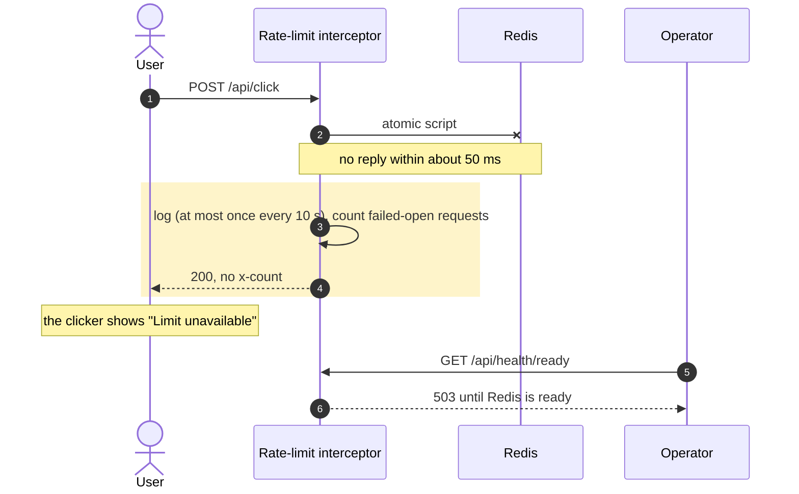

**Status:** Accepted · **Date:** 2026-10-31 · **Issue:** [#45](https://github.com/nitzanto/ratewatch/issues/45)

## Context and problem statement

Every limited request asks Redis before it runs. Redis can stop, fail over, or slow down. What does the API do with a request it can't count, how fast does it decide, and who finds out?

## Decision drivers

- **Availability:** a store outage must not stop the product.
- **Honesty:** the product never shows a count it doesn't have.
- **Performance:** a slow Redis must not make every request slow.
- **Operability:** operators learn about the outage at once; logs stay readable at full traffic.

## Considered options

1. **Fail open: serve the request without `x-count`**
2. Fail closed: refuse with 503 until Redis is back
3. Count in each API instance's memory during the outage

## Trade-off matrix

|                 | Fail open                                   | Fail closed                              | In-memory count during the outage                 |
| --------------- | ------------------------------------------- | ---------------------------------------- | ------------------------------------------------- |
| Scalability     | Not affected                                | Not affected                             | Fair: per-instance state while Redis is down      |
| Performance     | Strong: about 50 ms worst case, then normal | Strong                                   | Strong                                            |
| Reliability     | Strong: the product keeps working           | Weak: a store outage is a product outage | Strong                                            |
| Security        | Fair: no limit during the outage            | Strong: nobody exceeds a limit           | Good: a limit up to n times looser, n = instances |
| Maintainability | Strong: one branch                          | Strong                                   | Weak: a second counting path to test              |
| Honesty         | Strong: no count is shown                   | Strong                                   | Weak: the count differs between responses         |

## Decision outcome

Chosen option: **fail open**, because it's the only option that keeps the product available and never shows a wrong count.

- The Redis client has no offline queue and no retries: a command fails at once when the connection is down, and after about 50 ms when Redis doesn't reply. The load test sets the final timeout; it stays about 10 times the limit check's p99 target.
- Failures are logged at most once every 10 seconds, with the number of requests that failed open, so an outage doesn't write a log line per request.
- `GET /api/health/ready` answers 503 while the Redis connection isn't ready; `GET /api/health` stays the liveness check.

**Showing "Limit unavailable" is a product decision.** Most products hide a failure like this from the user. In ratewatch the limit is the product, so the user should know when it isn't being counted, rather than see an old number or nothing at all.

### Consequences

- Good, because a Redis outage never stops a User or an Admin from working.
- Good, because the user never sees a count that's wrong.
- Bad, because during the outage a user can send more than their limit, and successful requests carry no `x-count`.
- Bad, because a command that timed out may still have counted in Redis.
- Bad, because the dashboard's data also lives in Redis, so the dashboard stops updating during the outage.

### Confirmation

- Unit tests: a Redis error and a timeout both let the request through without `x-count`.
- A web component test: a response without `x-count` shows "Limit unavailable".
- Metric and alert: failed-open requests above 0 for 1 minute alert the operator.
- Revisit if the limit ever protects something costly, such as a paid upstream API: then fail closed for those routes.

## Notes on options

- **Fail closed** is the safer choice when exceeding the limit costs money or enables abuse. Here it turns any Redis outage into a full outage.
- **In-memory counting during the outage** keeps `x-count` on every response, but each instance counts alone, so a user's count jumps between responses and their limit is up to n times looser. Those requests are also never added to Redis afterwards.

## In the code

Planned with [#47](https://github.com/nitzanto/ratewatch/issues/47): the client options in the API's Redis module, the fail-open branch in the rate-limit interceptor, and the readiness endpoint on the health controller. The web side already exists: `requests-left.tsx` shows "Limit unavailable" when `x-count` is missing.
