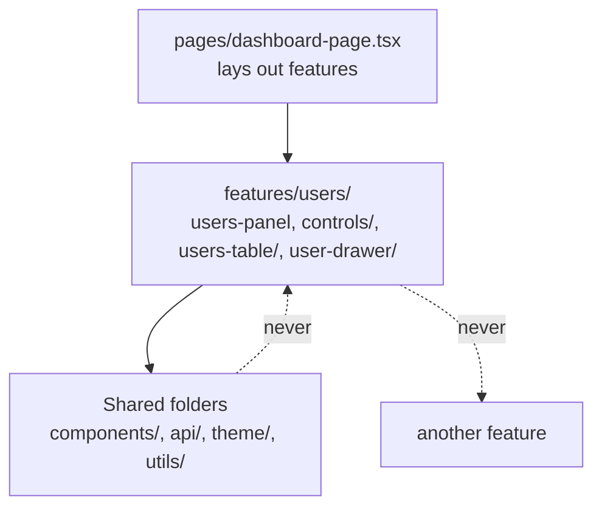

**Status:** Accepted · **Issues:** [#31](https://github.com/nitzanto/ratewatch/issues/31), [#84](https://github.com/nitzanto/ratewatch/issues/84)

The dashboard needed a shape that tells a developer or an agent where every file goes without inventing anything. The first version split `apps/web/src` by layer (`components/`, `hooks/`, `libs/`), with a `features/` folder for code only one feature used. As the users table grew, that shape stopped helping: one screen's code was spread over five folders, and the table's fifteen components sat in one flat list, so nothing said that a row belonged to the table or a form to the drawer.

We now keep **pages thin** and put each part of the product in a **feature folder** that mirrors the UI it builds. Code two or more features use lives in a few **shared folders**: `components/`, `api/` (one folder per resource, its queries and hooks together), `theme/`, `utils/`, `mocks/` and `test/`.

Inside a feature, every level follows the same rules:

- A component with parts gets a folder named after it, its main file inside (`users-table/users-table.tsx`). A component without parts stays a single file.
- Two or more parts with one role share a folder named for that role (`cells/`, `states/`, `controls/`); a single part sits next to its main file. At most one such level per component folder.
- `hooks/`, `utils/` and `types/` appear only at a feature's root, and only once there's a file for them.
- Each component's spec sits next to it, and a page's spec covers only how the page wires its parts.
- No `index.ts` barrels.

**Options considered**

- **Feature folders mirroring the UI, thin pages** (chosen).
- **Everything under the page** (`pages/dashboard/components/users/users-table/cells/…`): one folder per screen, but six levels deep before a file, past the three or four levels React's own guidance suggests, and every import gets longer.
- **Layers plus feature folders** (the previous version): one place for each kind of code, but a screen's code spread across five folders, and a large feature still a flat list.
- **A `components/` folder inside every component folder**: the most uniform, but `components/…/components/…` paths repeat themselves and get deep fast.

**Why:** a feature folder reads like the screen it builds, so finding a file means following the UI, and deleting a feature means deleting one folder. Shared folders stay small because only what two features use goes there. Keeping each resource's queries and hooks together in `api/` keeps query keys and cache updates in one place, since live updates write into several resources' caches at once.

**Trade-offs we accept:** someone has to decide whether new code is one feature's own or shared, and move it when a second feature needs it. Paths are longer than in a flat layout (`features/users/users-table/cells/reset-cell.tsx`). Lint enforces the direction: shared folders never import a feature or a page, features never import each other or a page, and pages never import each other.

**Revisit when:** a feature grows past one level of grouping folders, which is the sign it should split into two features.

**In the code:** the tree and the rules are in [Frontend architecture](../../architecture/frontend/#structure). The `@/` alias is set in `apps/web/tsconfig.app.json`, `apps/web/tsconfig.spec.json` and `apps/web/vite.config.mts`, and the import rules (`no-restricted-imports`) in `apps/web/eslint.config.mjs`.
