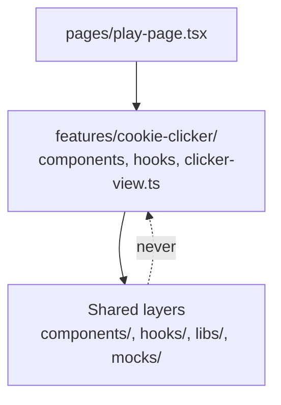

**Status:** Accepted · **Issue:** [#31](https://github.com/nitzanto/ratewatch/issues/31)

Every upcoming dashboard feature needs the same plumbing: an API call, a cached query, a hook, a component, a mock and a test. Without a shared shape, the first feature to land would set the pattern by accident. We split `apps/web/src` **by layer** (`pages/`, `components/`, `hooks/`, `libs/`, `mocks/`, …), and every layer holds one working example, so a feature starts by copying the example next to it.

Code that **only one feature uses** goes in that feature's own folder, `features/<feature>/`, for example `features/cookie-clicker/`, with its own `components/`, `hooks/` and pure logic. The API layer stays shared even when only one feature calls an endpoint, because its calls, hooks and mocks match one to one. When a second feature needs something from a feature folder, it moves up to a layer.

**Options considered**

- **Layers plus feature folders** (chosen): shared code by layer, each feature's own code together.
- **Layers only** (the first version of this decision): one place for each kind of code, but the cookie clicker's seven presentational parts, its view rules and its timers would sit among shared components and hooks, though nothing else uses them.
- **Feature folders only** (`features/users/…`): keep a feature's files together, but the dashboard is one domain. The live table, user detail, search and analytics all read the same users and rate-limit status, so most code would end up in a shared folder anyway, and every feature would draw its own line between "mine" and "shared".

**Why:** the features share their data far more than they differ, so shared code by layer, with a working example in each, is a template a developer or an agent can follow without inventing anything. Code only one feature uses stays next to that feature, so it doesn't crowd the shared layers and is easy to find and delete.

**Trade-offs we accept:** someone has to decide whether new code is shared or one feature's own, and move it when a second feature needs it. Lint enforces the direction: shared layers never import a feature, and features never import each other. An `@/` import alias keeps cross-layer imports readable.

**Revisit when:** the dashboard grows parts that share little data with the rest, where a feature folder would keep them apart.

**In the code:** the tree and what each layer holds are in [Frontend architecture](../../architecture/frontend/#structure). The `@/` alias is set in `apps/web/tsconfig.app.json`, `apps/web/tsconfig.spec.json` and `apps/web/vite.config.mts`, and the import rules (`no-restricted-imports`) in `apps/web/eslint.config.mjs`.
