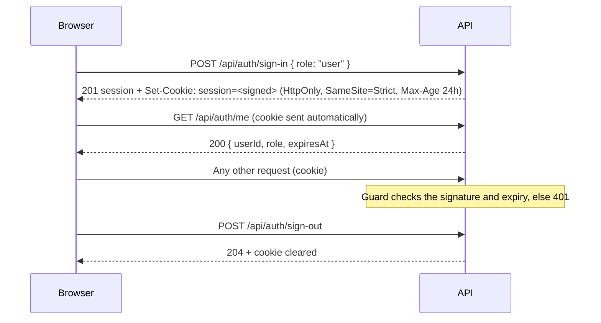

**Status:** Accepted · **Date:** 2026-10-31 · **Issue:** [#35](https://github.com/nitzanto/ratewatch/issues/35)

## Context and problem statement

The rate limit is per user ID, never per IP address or device, so every request must carry a user ID the API can trust. Admin endpoints (resetting a limit, pausing a user) must be kept from users, and the live dashboard's realtime connection must be kept to admins. ratewatch is a demo of the rate limiter: there's nobody to register and no need for passwords, but anyone trying it should be able to be a User in one window and the Admin in another. How does a person get an identity, and how does the API know it on every request?

## Decision drivers

- **Security:** the user ID and role can't be chosen per request or edited by the client; the credential can't be read by injected script or sent from another site.
- **Reliability:** API instances stay stateless, so any instance can authenticate any request.
- **Performance:** checking who's asking adds nothing measurable to the limit check.
- **Maintainability:** one way to authenticate both HTTP calls and the Socket.IO handshake, and a clear upgrade path to real accounts.
- **Demo fit:** trying either side takes one click, and a second browser is a second user.

## Considered options

1. Demo sign-in with a signed session cookie
2. Real accounts with passwords in Postgres
3. A user ID header sent by the client
4. A bearer token in an `Authorization` header
5. A session ID cookie backed by a store in Redis

## Trade-off matrix

|                 | Signed session cookie                                                   | Real accounts in Postgres                 | Client-sent user ID header                 | Bearer token header                                        | Session store in Redis                    |
| --------------- | ----------------------------------------------------------------------- | ----------------------------------------- | ------------------------------------------ | ---------------------------------------------------------- | ----------------------------------------- |
| Scalability     | Strong: no server state                                                 | Good: one more shared database            | Strong                                     | Strong                                                     | Good: every request reads Redis           |
| Performance     | Strong: one HMAC check, in memory                                       | Strong once signed in                     | Strong                                     | Strong                                                     | Fair: a store round trip on every request |
| Reliability     | Strong: nothing to be down                                              | Fair: sign-in depends on the database     | Strong                                     | Strong                                                     | Fair: sessions depend on Redis being up   |
| Security        | Good: unforgeable, unreadable by script; can't be revoked before expiry | Strong: real identities, revocable        | None: anyone can be anyone, admin included | Fair: page script holds the token, open to injected script | Strong: revocable at once                 |
| Maintainability | Strong: one cookie for HTTP and the WebSocket handshake                 | Weak: registration, passwords, a database | Strong                                     | Fair: the handshake must pass the token by hand            | Fair: a store and expiry to manage        |
| Demo fit        | Strong: one click, a new user per sign-in                               | Weak: registration before trying anything | Strong                                     | Good                                                       | Strong                                    |

## Decision outcome

Chosen option: **demo sign-in with a signed session cookie**, because it's the only option that is strong on security and demo fit at once without adding state: the server trusts only what it signed, and trying either side takes one click.

- **Sign in as User** creates a new random user ID (`user-` plus 8 hex characters) every time, so a private window is a second user with their own limit. **Sign in as Admin** gives the fixed ID `admin`.
- The session (user ID, role, expiry) is the cookie's value, signed with `SESSION_SECRET`. A cookie whose value was edited (for example, to change the role) fails the signature check and gets a 401.
- A session lasts **24 hours from sign-in** and is never extended. The cookie's `Max-Age` matches, so the browser drops it at the same moment.
- Every endpoint answers 401 without a valid session, except sign-in, sign-out and health.
- An endpoint marked with roles (`@Roles('admin')`, or `@Roles('admin', 'user')`) answers 403 to a signed-in person whose role isn't listed; one with no roles is open to every signed-in person. A handler's roles override its controller's. Today only admin endpoints are marked.
- The web app follows the same roles. Opening `/` sends the Admin to the dashboard (`/dashboard`) and a User to the cookie clicker (`/play`). Users don't see the Dashboard tab, and a User who opens an admin page gets the not-found page, so the web app never reveals that admin pages exist. Hiding them is a courtesy; the API's 403 is the protection.

### Consequences

- Good, because API instances share nothing but the secret, so authentication scales with them.
- Good, because the browser sends the cookie on API calls and on the Socket.IO handshake by itself: nginx serves both on one origin, so `SameSite=Strict` never gets in the way.
- Bad, because a session can't be revoked before it expires: signing out clears the browser's cookie, but a copy stays valid until its 24 hours are up. The fixed expiry is what limits that.
- Good, because a session that expires or was edited mid-use ends the same way as signing out: the next request gets a 401, the web app clears the session, and the person lands on sign-in. The check sits on the query client's cache rather than the API client, because only the cache holds the session, and the API client also sees the 401 that `/auth/me` gives every signed-out visitor.
- Good, because sign-in returns a visitor to the page they opened. That page travels in the router's state, never in a query parameter, so a link from another site can't choose where sign-in sends someone. Signing out doesn't pass it on, so the next person starts on their own start page.
- Bad, because changing `SESSION_SECRET` signs everyone out.
- Bad, because anyone can sign in as the Admin. That's acceptable only while ratewatch isn't deployed publicly.

### Confirmation

- API tests over HTTP cover sign-in, sign-out, a missing, edited or expired cookie (401), an unmarked endpoint answering 401, and a role-marked endpoint answering 403 to a role it doesn't list.
- Web component tests cover each role's start page, the Dashboard tab hidden from Users, a User getting the not-found page on the dashboard, returning to the opened page after sign-in, signing out without passing that page on, and a 401 mid-use sending the person to sign-in and back.
- A Playwright journey signs in, reloads (the session survives) and signs out.
- Revisit when ratewatch needs real people or a public deployment: then real accounts move users and custom limits to Postgres, Redis keeps the counters, and the cookie stays as it is.

## Notes on the options

- **Session store in Redis** scores well on security because a session can be revoked at once. It was rejected because for a demo that benefit doesn't justify a store lookup on every request, or making sign-in depend on the store being up.
- **Real accounts** is the upgrade path, not a rejected direction: only how a session is first issued would change.

## In the code

- `apps/api/src/app/auth/`: `controllers/` (sign-in, sign-out and `me`), `services/auth.service.ts` (issues and reads sessions), `guards/session.guard.ts` (the global guard), and `decorators/`: `@Public()` for routes that need no session, `@Roles(...)` for routes only some roles may use, `@CurrentSession()` for handlers that read it. `cookie-parser` checks the signature; it's registered for the whole app in `main.ts`.
- `libs/contracts/src/lib/session.schema.ts`: the session and sign-in request shapes.
- `apps/web/src/libs/api/session-queries.ts`: restores the session on load and signs in and out. The session is a TanStack Query entry rather than a React context, because it's server state that only signing in or out changes; signing in or out drops every other cached query, since it belonged to the last person.
- `apps/web/src/app/app-shell.tsx`: sends anyone without a session to the sign-in page, and shows who is signed in. The page they were on travels in router state, so sign-in returns them to it; signing out doesn't pass it on, so the next person starts on their own start page.
- `apps/web/src/app/route-guards.tsx`: `RoleLanding` sends `/` to the role's start page, and `AdminRoute`, the layout route around admin pages, shows a User the not-found page. The app shell hides admin-only tabs from Users.
- `apps/web/src/app/providers.tsx`: any query or mutation answered 401 (a session that expired or was edited mid-use) clears the session, which sends the person to sign-in the same way.
