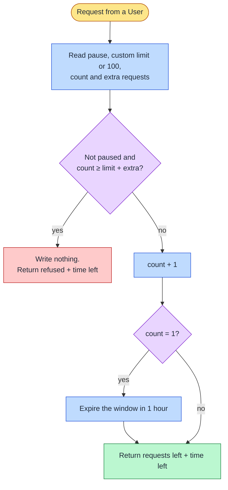

**Status:** Accepted · **Date:** 2026-10-31 · **Issue:** [#45](https://github.com/nitzanto/ratewatch/issues/45)

## Context and problem statement

Each user gets 100 requests per hour, or their custom limit, plus any extra requests for the current window. The limit must hold exactly when many requests arrive at once, and be the same on every API instance. Every successful request reports the requests left in `x-count`; a refused one gets a 429 with the time the user can try again, and must not use up the limit. Admins can pause a user's limit. Where does the check run, what window does it count in, and how is the count kept correct under concurrency?

## Decision drivers

- **Correctness:** exactly the limit succeeds under concurrent requests, on any number of instances.
- **The product contract:** a single number for "requests left" and a single reset time for the 429.
- **Performance:** the check adds less than 1 ms at p50 and 5 ms at p99, at up to 100,000 requests per second.
- **Identity:** the key is the signed session's user ID, which only the API can read.
- **Admin controls:** custom limit, extra requests and pause apply on the next request.

## Considered options

Where the check runs:

1. **An interceptor in every API instance, against a shared Redis**
2. An API gateway in front of the services
3. A per-instance in-memory counter

Which window:

1. **Fixed window from the user's first request**
2. Fixed window on the clock hour
3. Sliding log
4. Sliding window counter
5. Token bucket

## Trade-off matrix

Where the check runs:

|                 | Interceptor + shared Redis                                   | API gateway                                         | In-memory per instance                             |
| --------------- | ------------------------------------------------------------ | --------------------------------------------------- | -------------------------------------------------- |
| Scalability     | Strong: stateless instances; Redis Cluster split by user     | Strong, with the same Redis behind it               | Weak: the limit multiplies with the instance count |
| Performance     | Strong: one round trip; refused requests reach the API       | Strong: refused requests never reach a service      | Best: no network                                   |
| Reliability     | Good: depends on Redis, see [Failure mode](../failure-mode/) | Good: depends on Redis and one more component       | Strong: no dependency                              |
| Security        | Strong: uses the user ID the session guard verified          | Fair: needs its own copy of the session check       | Strong                                             |
| Maintainability | Strong: one place decides the limit, in the app's language   | Weak: the session check and admin rules exist twice | Strong                                             |
| Correctness     | Strong                                                       | Strong                                              | None across instances                              |

Which window:

|                    | Fixed from first request                         | Clock hour                                        | Sliding log                          | Sliding counter                    | Token bucket                                   |
| ------------------ | ------------------------------------------------ | ------------------------------------------------- | ------------------------------------ | ---------------------------------- | ---------------------------------------------- |
| Scalability        | Strong: one small hash per active user           | Strong                                            | Fair: up to `limit` entries per user | Strong: two counters               | Strong: two fields                             |
| Performance        | Strong: one script, O(1)                         | Strong: works without a script                    | Fair: O(log n) per request           | Strong                             | Strong                                         |
| Reliability        | Strong                                           | Fair: every user resets at the same moment        | Strong                               | Strong                             | Strong                                         |
| Security           | Not affected                                     | Not affected                                      | Not affected                         | Not affected                       | Not affected                                   |
| Maintainability    | Strong: the key's expiry is the reset time       | Strong                                            | Fair                                 | Fair: weighted estimate to explain | Fair: refill maths                             |
| Fits the contract  | Strong: one count, one reset time                | Fair: reset isn't "an hour from my first request" | Weak: no single reset time           | Weak: approximate count            | Weak: "requests left" changes as tokens refill |
| Bursts at the edge | A full limit at the end and start of two windows | The same                                          | None                                 | Small                              | None                                           |

## Decision outcome

Chosen options: **an interceptor in every API instance, against a shared Redis**, and **a fixed window from the user's first request**, counted by **one Lua script per request**. Only the API can verify the session and knows the admin rules, so it's the one place that decides; a shared store makes the limit global. The fixed window is the only one that gives the product a single count and a single reset time.

Redis runs a script as one step, so the check and the increment can never interleave. Each of a user's keys contains the user ID in braces, for example `rl:{user-3f9a1c2e}:window`, so Redis Cluster keeps them on one shard and one script can use them all.

### Consequences

- Good, because a refused request writes nothing, so it never uses up the limit, and no two requests can take the last one.
- Good, because the window's expiry is the reset time: no clock maths in the API, and nothing to clean up.
- Good, because adding API instances never changes anyone's limit.
- Bad, because a user can spend a full limit at the end of one window and another at the start of the next.
- Bad, because refused requests still cost a Redis call. If load tests show it matters, each instance can remember "refused until the reset time" and answer 429 without one; admin changes then have to clear that memory on every instance.
- Bad, because Redis replication is asynchronous: a failover can lose the last increments, so a user may get a few extra requests.

### Confirmation

- Unit tests drive the interceptor through the window, refused requests, custom limit, extra requests and pause, with a mock Redis.
- An integration test against a real Redis sends 150 simultaneous requests for one user: exactly 100 succeed.
- The load test checks that no user's allowed requests in a window exceed their limit, and the limit-check latency targets.

## Notes on options

- **API gateway** is the right place when many services share one limit and the gateway can identify the user by itself, such as with a signed token it verifies. ratewatch has one service and a session cookie only the API can verify. A gateway would also call Redis once per request, so it moves the load rather than removing it. Revisit when a second service needs the same limit.
- **Clock-hour windows** are the one case where an absolute expiry (`EXPIREAT`) is natural, but they reset every user at the same moment, and that isn't what the product promises.
- **`@nestjs/throttler`** is a guard, not an interceptor; its Redis storage increments before checking, so refused requests count; and it has no custom limit, extra requests or pause.
- `EXPIRE` is set only when the window opens. Setting it on every request would push the reset time back as long as the user kept sending.

## In the code

Planned with [#46](https://github.com/nitzanto/ratewatch/issues/46): the interceptor and its Lua script in the API's rate-limit module, and the Redis service in `compose.yaml`. The script, keys and expiries are in the [rate limiting and live dashboard design doc](../../design-docs/rate-limiting-and-live-dashboard/).
