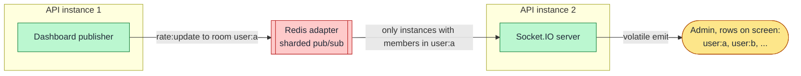

**Status:** Accepted · **Date:** 2026-10-31 · **Issue:** [#45](https://github.com/nitzanto/ratewatch/issues/45)

## Context and problem statement

Admins watch users' numbers change as requests happen: in the users table, in the open user's event stream, and in the summary cards. Requests land on any API instance, and admins are connected to any instance. The events are `rate:update` and `rate:limit_exceeded`, over `@nestjs/websockets`. How do events reach the right admins, and how does that hold with very many users?

## Decision drivers

- **Scalability:** the events an admin receives must not grow with the number of users.
- **Reliability:** reconnect after a network drop, and recover the current state.
- **Security:** only the Admin can connect.
- **Maintainability:** no transport plumbing of our own.

## Considered options

1. **Socket.IO with its sharded Redis adapter, with rooms for what each admin sees**
2. Socket.IO, broadcasting every user's updates to every admin
3. Plain WebSockets
4. Server-sent events
5. Polling

## Trade-off matrix

|                 | Socket.IO + rooms                              | Socket.IO broadcast                           | Plain WebSockets                       | Server-sent events                       | Polling                          |
| --------------- | ---------------------------------------------- | --------------------------------------------- | -------------------------------------- | ---------------------------------------- | -------------------------------- |
| Scalability     | Strong: events follow what's on screen         | Weak: every active user's events, to everyone | Fair: fan-out across instances is ours | Fair: fan-out across instances is ours   | Good: but a request per interval |
| Performance     | Strong: at most one update per user per second | Weak at large user counts                     | Strong                                 | Strong                                   | Fair: delay up to one interval   |
| Reliability     | Strong: reconnect built in                     | Strong                                        | Weak: we build reconnect               | Good: browser reconnects                 | Strong                           |
| Security        | Strong: cookie checked at the handshake        | Strong                                        | Strong                                 | Strong                                   | Strong                           |
| Maintainability | Strong: rooms and adapter are built in         | Strong                                        | Weak: rooms and fan-out to build       | Fair: subscribing needs a second channel | Strong                           |

## Decision outcome

Chosen option: **Socket.IO with its sharded Redis adapter, and rooms for what each admin sees**, because it's the only option where an admin's event load stays flat as users grow, with reconnect and cross-instance fan-out built in.

- **Rooms:** one per user row on screen (at most 100) plus the open user, and `admins` for summary numbers and `rate:limit_exceeded`. The web app tells the server which rows it shows; the server replies with their current numbers, so nothing is missed between the page load and the subscription.
- **`rate:update`:** at most once per second per user from each instance, with the latest numbers. Sent volatile: if the admin's connection isn't ready, it's dropped, because a newer one follows.
- **`rate:limit_exceeded`:** sent at once, exactly once per user per window.
- **Handshake:** the signed session cookie is checked; anyone but the Admin is refused.

### Consequences

- Good, because the cost of live updates depends on admins, not on users.
- Good, because the Redis adapter's sharded mode only notifies instances that have members in a room.
- Bad, because an admin sees live changes only for rows on screen; another page is current when it's opened.
- Bad, because with several instances, Socket.IO's HTTP long-polling fallback needs sticky sessions at the load balancer.
- Bad, because two instances can each send an update for the same user in the same second; the web app keeps the newer one.

### Confirmation

- API tests with a Socket.IO client: the Admin-only handshake, room subscription, throttling and event payloads.
- Web component tests receive events through the mocked socket.
- Metric: time from a request to its `rate:update` stays under 2 seconds at p95.

## Notes on options

- **Broadcasting everything** is the simplest and works for tens of users, but at a million active users it means up to a million events per second to each admin.
- **Server-sent events** are one-way, so telling the server which rows are on screen needs separate HTTP calls; fan-out across instances still needs Redis pub/sub of our own.

## In the code

Planned with [#49](https://github.com/nitzanto/ratewatch/issues/49): the realtime gateway in the API, the Socket.IO client in the web app, and the event payloads in `libs/contracts`. The rooms and payloads are in the [rate limiting and live dashboard design doc](../../design-docs/rate-limiting-and-live-dashboard/).
