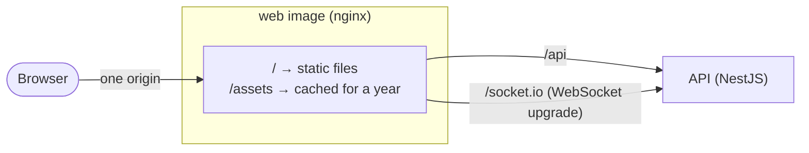

**Status:** Accepted · **Date:** 2026-10-30 · **Issue:** [#13](https://github.com/nitzanto/ratewatch/issues/13)

## Context and problem statement

The dashboard calls the API over HTTP and, soon, receives live updates over WebSockets. If the two are served from different origins, the browser enforces CORS on every call, the dashboard must know the API's URL, and that URL differs per environment. The dashboard is built once into static files, and we want one image that runs unchanged in every environment. How should the browser reach the API?

## Decision drivers

- **Security:** no cross-origin requests to configure or get wrong; cookies stay first-party when auth arrives.
- **Maintainability:** one image per app for every environment, with no build-time URLs.
- **Performance:** static files served with long-lived caching and compression, without going through Node.
- **Fit:** works for both `/api` and WebSocket upgrades on `/socket.io`, and maps to a Kubernetes Ingress later.

## Considered options

1. nginx in the web image serves the dashboard and proxies `/api` and `/socket.io`
2. CORS, with the API on its own origin
3. The API serves the dashboard's static files
4. A separate gateway (Traefik or Envoy)

## Trade-off matrix

|                 | nginx proxy in the web image                             | CORS, separate origins                              | API serves static files                     | Separate gateway                       |
| --------------- | -------------------------------------------------------- | --------------------------------------------------- | ------------------------------------------- | -------------------------------------- |
| Scalability     | Strong: web and API scale separately                     | Strong                                              | Weak: the dashboard scales with the API     | Strong                                 |
| Performance     | Strong: nginx caches and compresses static files         | Fair: preflight requests on credentialed calls      | Fair: Node serves static files              | Strong                                 |
| Reliability     | Strong: one hop, one config file                         | Good                                                | Good: one container fewer                   | Fair: one more service to run          |
| Security        | Strong: no CORS; headers set in one place                | Fair: CORS policy to get right in every environment | Good                                        | Strong                                 |
| Maintainability | Strong: API address is runtime config; one image per app | Weak: API URL built into the dashboard              | Fair: caching and headers move into the API | Fair: a third component for two routes |

## Decision outcome

Chosen option: **nginx in the web image**, because it's the only option that wins on security and maintainability without adding a service: the browser sees one origin, and the API's address is set when the container starts, not when the dashboard is built.

In development, Vite's proxy plays the same role, so the dashboard's code calls relative `/api/...` URLs everywhere.

### Consequences

- Good, because the API has no CORS configuration and the dashboard has no API URL.
- Good, because static caching and security headers live in one nginx config.
- Bad, because the web image depends on knowing the API's address (`API_URL`) at start.
- Bad, because nginx config is a second language in the repo; its behaviour is checked by CI rather than unit tests.
- Bad, because nginx looks up the API's address once at start; if the API container gets a new address, nginx must restart too. Compose starts nginx only once the API is healthy; Kubernetes will route through a stable Service address.

### Confirmation

- CI starts the production images and calls `/api/health` through nginx on every pull request that affects either app.
- Revisit when the Kubernetes Ingress lands: it may take over the routing, leaving nginx to serve files only.

## In the code

- `apps/web/nginx/default.conf.template`: routing, caching and headers. `API_URL` is filled in when the container starts.
  - **Caching:** Vite puts a content hash in every file name under `/assets/`, so those are cached for a year as `immutable`. `index.html` is `no-cache`, so a deploy shows up on the next load. API responses keep their own caching headers, and error responses are never cached.
  - **Security headers** (`X-Content-Type-Options`, `Referrer-Policy`, `frame-ancestors`) are set once for every response. nginx drops server-level headers in any location that sets its own, so the config picks the `Cache-Control` value with a `map` instead of per-location headers.
- `apps/web/Dockerfile`: the `prod` stage on `nginx-unprivileged`.
- `apps/web/vite.config.mts`: the development proxy.
