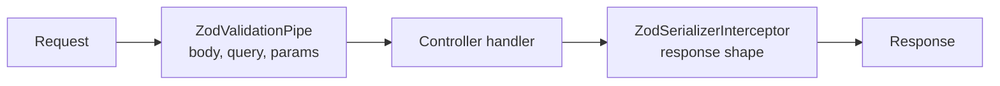

The API (`apps/api`) is a NestJS 11 application on Express. This page covers how it's built inside: structure, cross-cutting concerns and conventions. Why NestJS 11 on Express is in [Backend framework](../../adrs/backend-framework/).

## Structure

```text
apps/api/src/
├── main.ts                    # bootstrap: /api prefix, port, readiness signal
└── app/
    ├── app.module.ts          # root module: config, global validation
    ├── env.ts                 # schema for the API's environment variables
    ├── health.controller.ts   # GET /api/health
    └── health.controller.spec.ts
```

Each feature will get its own NestJS module next to `app/` (for example `rate-limit/`), holding its controller, providers and tests. `AppModule` imports the feature modules.

## Request pipeline



- **Input validation.** A global `ZodValidationPipe` validates every body, query and route parameter against its DTO. DTOs are built from the shared contracts with `createZodDto`.
- **Output validation.** A global `ZodSerializerInterceptor` checks the response of every route marked `@ZodSerializerDto`.
- **Rate limiting** will be an interceptor in this pipeline, ahead of the handler.

## Configuration

Settings that vary between deploys (port, session secret, Redis URL) are environment variables. `ConfigModule` validates them against the schema in `env.ts` at startup, and the API refuses to start if any is missing or invalid, naming each one. Code reads them through `ConfigService<Env, true>`, not `process.env`. The variables and their local defaults are in [Runtime configuration](../../adrs/runtime-config/).

## Testing

Unit tests use Vitest with `unplugin-swc`, so NestJS's decorator metadata survives the test transform. Controllers are tested through `@nestjs/testing`. The API is also covered end to end by the `api` Playwright suite.

## Decisions to make

These are open and will be decided with the feature that needs them; each gets an ADR and a row in the [decision log](../../adrs/architecture-decisions/#decision-log).

- Rate-limit store, algorithm and failure mode (with the rate-limiting feature).
- Realtime gateway and fan-out across API instances (with the live dashboard).
- Authentication and how the user ID reaches the rate limiter (with the auth feature).
