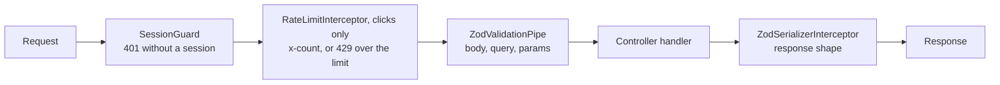

The API (`apps/api`) is a NestJS 11 application on Express. This page covers how it's built inside: structure, cross-cutting concerns and conventions. Why NestJS 11 on Express is in [Backend framework](../../adrs/backend-framework/).

## Structure

```text
apps/api/src/
├── main.ts                    # bootstrap: /api prefix, cookie-parser, port, readiness signal
└── app/
    ├── app.module.ts          # root module: config, global validation
    ├── auth/                  # a feature module, one folder per kind of file:
    │   ├── controllers/       #   sign-in, sign-out, me (spec beside it)
    │   ├── decorators/        #   @Public(), @Roles(), @CurrentSession()
    │   ├── dto/               #   Zod DTOs from the shared contracts
    │   ├── guards/            #   the global SessionGuard (spec beside it)
    │   ├── interfaces/        #   SessionRequest
    │   ├── modules/           #   AuthModule
    │   ├── services/          #   AuthService: issues and reads sessions
    │   └── constants/         #   cookie name, session lifetime
    ├── clicks/controllers/    # POST /api/clicks: the cookie clicker's request
    ├── rate-limit/            # RateLimitInterceptor (applied to clicks), its Lua script and keys (specs beside it)
    ├── redis/                 # RedisModule: one shared, fail-fast ioredis client (built in providers/), injected by the redisClient token
    ├── test-utils/            # shared test helpers: startApp(), sign-in and click helpers, a fake Redis
    ├── env.ts                 # schema for the API's environment variables
    ├── health.controller.ts   # GET /api/health: liveness and readiness, never checks Redis
    └── health.controller.spec.ts
```

Each feature gets its own folder under `app/` (for example `rate-limit/`), laid out like `auth/`: one subfolder per kind of file, holding only the kinds it has, with each test next to the file it tests. `AppModule` imports the feature modules.

## Request pipeline



- **Authentication.** A global `SessionGuard` reads the signed `session` cookie and answers 401 when it's missing, edited or expired. Routes that need no session are marked `@Public()` (sign-in, sign-out, health); routes only some roles may use are marked `@Roles(...)` (for example `@Roles('admin')`), and the same guard answers 403 to any other role. Unmarked routes are open to every signed-in role. A handler reads the signed-in person with `@CurrentSession()`; the rate limiter reads the user ID from the same place. See [Identity and roles](../../adrs/identity-and-roles/).
- **Input validation.** A global `ZodValidationPipe` validates every body, query and route parameter against its DTO. DTOs are built from the shared contracts with `createZodDto`.
- **Output validation.** A global `ZodSerializerInterceptor` checks the response of every route marked `@ZodSerializerDto`.
- **Rate limiting.** `RateLimitInterceptor` applies only to `POST /api/clicks` (`@UseInterceptors` on the clicks controller). It runs after the guard, so it knows the user. It counts each click with one atomic Lua script in Redis, sets `x-count` to the requests left, and answers 429 with the reset time over the limit, before the handler runs. Every other route, including `GET /api/auth/me`, and every Admin request is never counted, so a User over the limit can still load the app. When Redis can't answer within about 50 ms, the request goes through without `x-count` (fail open), the interceptor logs at most once every 10 seconds, and the Redis client logs when the connection fails and when it's back. `GET /api/health` never checks Redis, so an outage doesn't take the API out of service. See [Rate-limit store and window](../../adrs/rate-limit-store/), [Failure mode](../../adrs/failure-mode/) and the [design doc](../../design-docs/rate-limiting-and-live-dashboard/).

## Configuration

Settings that vary between deploys (port, session secret, Redis URL) are environment variables. `ConfigModule` validates them against the schema in `env.ts` at startup, and the API refuses to start if any is missing or invalid, naming each one. Code reads them through `ConfigService<Env, true>`, not `process.env`. The variables and their local defaults are in [Runtime configuration](../../adrs/runtime-config/).

## Testing

Unit tests use Vitest with `unplugin-swc`, so NestJS's decorator metadata survives the test transform. Controllers are tested over HTTP against the whole app, started on a free port by `startApp()` in `app/test-utils/test-app.ts`, which also takes test-only controllers (for example, one that breaks its contract, or one that isn't public). It swaps Redis for `ioredis-mock`, which runs the real Lua script, unless a test passes a real client: the concurrency test starts a real Redis with Testcontainers, so it needs Docker, and the failure tests use `test-utils/fake-redis.ts`, a Redis that is unreachable or stops answering. The API is also covered end to end by the `api` Playwright suite.

## Decisions to make

These are open and will be decided with the feature that needs them; each gets an ADR and a row in the [decision log](../../adrs/architecture-decisions/#decision-log).

- Rate-limit store, algorithm and failure mode (with the rate-limiting feature).
- Realtime gateway and fan-out across API instances (with the live dashboard).
