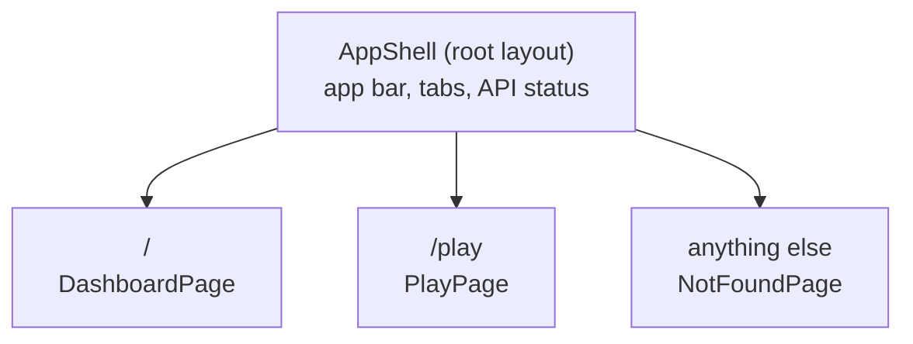
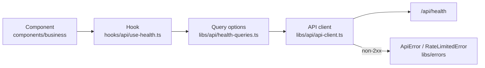
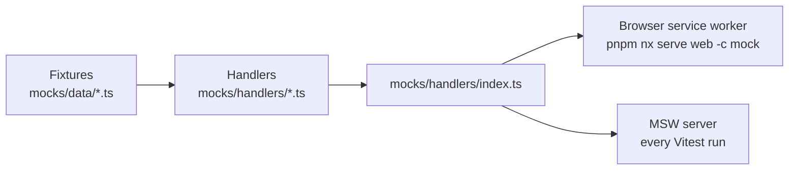

The dashboard (`apps/web`) is a React 19 single-page app built with Vite and styled with MUI. This page covers how it's built inside. Why React and MUI are in [Frontend framework](../../adrs/frontend-framework/) and [UI library](../../adrs/ui-library/).

## Structure

The source is split by **layer**, not by feature, and every layer holds one working example: start a feature by copying the example next to it. Why layers is in [Folder layout](../../adrs/folder-layout/).

```text
apps/web/src/
├── main.tsx                  # entry: fonts, providers, the browser router and the mock-mode worker
├── app/
│   ├── routes.tsx            # the route table, every page inside the shell
│   ├── route-paths.ts        # ROUTES: every page's URL, defined once
│   ├── app-shell.tsx         # the root layout: app bar, tabs, API status pill
│   ├── app.spec.tsx
│   └── providers.tsx         # query client, theme, CssBaseline
├── pages/                    # one component per route, e.g. dashboard-page.tsx
├── features/                 # code only one feature uses, e.g. cookie-clicker/
│   └── cookie-clicker/       # components/, hooks/, clicker-view.ts (its rules, unit-tested)
├── components/
│   ├── business/             # tied to domain logic, e.g. health-status.tsx
│   └── ui/                   # presentational only, no domain coupling, e.g. crumb.tsx
├── hooks/
│   ├── api/                  # one-line query and mutation hooks, e.g. use-health.ts
│   └── ui/                   # shared hooks with no server state
├── contexts/                 # real cross-cutting state only (none yet: the session is server state, in TanStack Query)
├── libs/
│   ├── api/                  # API client and one module per resource
│   ├── errors/               # ApiError, RateLimitedError
│   ├── rate-limit/           # rate-limit rules the UI derives, e.g. a status from requests left
│   ├── theme/                # the design system: palette, typography, sizes, components/
│   ├── test-utils/           # the app render helper (tests only)
│   ├── utils/                # shared helpers, e.g. format-time.ts
│   └── observability/        # error tracking
├── mocks/
│   ├── data/                 # contract-typed fixtures, one file per resource
│   ├── handlers/             # MSW handlers, one file per resource, plus index.ts
│   └── node.ts               # MSW server for Vitest
└── test-setup.ts             # starts the MSW server for every test file
```

Some layers exist only on this page so far: `hooks/ui`, `contexts` and `libs/observability`. A folder is created with its first real file, never as an empty placeholder.

**Shared layers, or a feature folder?** Code that more than one feature uses goes in a layer. Code that only one feature uses goes in `features/<feature>/`, with just the folders it needs. For example, the cookie clicker's card parts, its countdown timer and its view rules (`clicker-view.ts`) are there, while Crumb, the status chip and the whole API layer stay shared. When a second feature needs something from a feature folder, move it up to a layer. Lint enforces the direction: a layer never imports a feature, and features never import each other. Why is in [Folder layout](../../adrs/folder-layout/).

Import across layers with the `@/` alias for `src/` (`import { api } from '@/libs/api/api-client'`). TypeScript resolves it from `tsconfig.app.json` and `tsconfig.spec.json`, and Vite and Vitest from `vite.config.mts`.

## Routing

Pages are routed by **React Router** in data mode. Why is in [Routing](../../adrs/routing/).



- **One route table**, `app/routes.tsx`. The app shell is a pathless layout route, so every page, the not-found page included, renders inside it. `main.tsx` builds the browser router from the table; tests build a memory router from the same table.
- **URLs are constants.** `ROUTES` in `app/route-paths.ts` holds every page's URL. The route table, the app bar's tabs and every link read it, so changing a URL is a one-line change and a typo doesn't compile.
- **Tabs are links.** The app bar's tabs are `NavLink`s, so the current page gets `aria-current="page"` and its underline from that attribute.
- **Deep links work in production.** nginx answers any path that isn't a file or `/api` with `index.html`, and the router takes it from there.

To add a page: add its URL to `ROUTES`, its component to `pages/`, and a route to the table; add a tab in `app-shell.tsx` if it belongs in the app bar.

## Talking to the API

Server state lives in **TanStack Query**. Why is in [Server state](../../adrs/server-state/). A request passes through four layers, each with one job:



- **The API client** (`createApiClient`) has `get`, `post` and `patch`. Every call takes the response's Zod schema from the shared contracts and returns what the schema parsed, so no caller can name a response type it never checked. The API is a trust boundary for the browser too. One instance, `api`, is exported; the factory stays so a second API can build its own. Components and tests never swap the client: tests change what the network answers, with MSW.
- **Relative URLs.** The client's base URL is `/api`. In development Vite proxies `/api` to the API; in production both are served from one origin.
- **Errors are typed.** A non-2xx response throws an `ApiError` with its status and parsed body. A 429 whose body matches the contract becomes a `RateLimitedError`, carrying the message and `retryAt`, the time the user can try again. A 429 with a malformed body stays a plain `ApiError`. The client's `onError` option sees every failure; error tracking plugs in there. A 401 from any query or mutation means the session expired or was edited: the query client's cache-level `onError` (`createQueryClient` in `app/providers.tsx`) clears the session, and the app shell sends the person to sign-in, which returns them to the same page once they sign in again.
- **Response headers are asked for.** `get`, `post` and `patch` return the parsed body. A call that needs a header passes the headers' schema from the shared contracts as `responseHeaders`, and gets back `{ data, responseHeaders }`, both parsed: `api.post('/clicks', clickResponseSchema, { responseHeaders: rateLimitHeadersSchema })`. The client knows nothing about any particular header, and a header is checked against the contract like a body. A request body goes in the same options object (`{ body }`).
- **The user's rate limit is one cache entry.** `postClick` reads `x-count` through `rateLimitHeadersSchema` and returns it with the click: an integer, or `null` when the header is missing or malformed. The click mutation then writes what happened under `rateLimitQueryKey`, as a `RateLimit` (`libs/api/click-queries.ts`):
  - `counted` after a success, with the count and the one before it.
  - `refused` after a 429, with the message and the retry time.
  - `reset` once the wait has run out (`useEndWait()`).

  Any other failure leaves the entry as it was. Components read it with `useRateLimit()`, which is `undefined` before the first click. Because the entry lives in the cache rather than in the click's own state, a wait still pauses clicking after the user leaves the page and comes back, and the next click in flight never brings back a count from before the reset. A `null` count shows "Limit unavailable" rather than an old number.

- **Resource modules** (`libs/api/<resource>-queries.ts`) export the resource's query key as a constant (`healthQueryKey = ['health']`), the plain calls, and a query-options factory (`healthQueries.status()` builds the full `queryOptions` on that key). A write uses `mutationOptions` the same way (`clickMutations.click()`), with a mutation key only once something filters or sets defaults by it. Fetching, prefetching and invalidation (`queryClient.invalidateQueries({ queryKey: healthQueryKey })`) all import the same constant, so a key is never retyped as a string.
- **Hooks** are one line: `useHealth = () => useQuery(healthQueries.status())`, `useClick = () => useMutation(clickMutations.click())`. Components never fetch directly.
- **No automatic retries or focus refetches.** Against a rate-limited API every extra request spends the user's allowance, so a query fails at once and shows its error, and returning to the tab doesn't fetch again. Live data will arrive over the realtime connection instead.
- **Devtools.** In development, the TanStack Query devtools button (bottom corner) shows every cached query and mutation, the session and the rate limit included. `main.tsx` mounts it; production builds leave it out.
- **Lint.** `@tanstack/eslint-plugin-query` checks query keys against the query function's inputs and catches unstable query clients.

## No `useEffect`

Components never call `useEffect`, and lint fails if they do. Most effects are a workaround for something with a better tool: derive values during render, do work in event handlers, fetch through a `hooks/api` hook, and reset a component with a `key`. React's own guide, [You Might Not Need an Effect](https://react.dev/learn/you-might-not-need-an-effect), explains each one. The rare real sync with an outside system on mount, such as focusing an element or subscribing to a browser API, goes through a `useMountEffect` hook in `hooks/ui/`. A component's own timer, such as the clicker's countdown (`features/cookie-clicker/hooks/use-countdown.ts`), calls `useEffect` with a cleanup and switches the lint rule off on that one line, with a comment saying why. It runs only while that component is on screen.

## Styling

Components use MUI and style with the `sx` prop and theme tokens, never separate CSS files. The theme in `libs/theme/` carries the design system from the [Design](../../design/) page, one concern per file:

| File                   | Holds                                                                                                                                                                                                                 |
| ---------------------- | --------------------------------------------------------------------------------------------------------------------------------------------------------------------------------------------------------------------- |
| `palette.ts`           | Every colour. The rate-limit statuses use MUI's standard slots: `success` is OK, `warning` is Warning, `error` is Exceeded. Custom keys: `shell`, `crumb`, `paused`, `liveFlash`, `dataBar`, `border`, `neutralFill`. |
| `typography.ts`        | IBM Plex Sans (self-hosted with `@fontsource/ibm-plex-sans`), semibold headings, sentence-case buttons, and the `countHero` variant for the clicker's big number.                                                     |
| `sizes.ts`             | Fixed sizes such as the app bar height, the content width and Crumb's sizes. Spacing uses the theme's 8px grid.                                                                                                       |
| `components/<name>.ts` | One file per MUI component: its default props, style overrides and custom variants, such as the app bar's `shellTab` button and the `shell` and `status` chips.                                                       |
| `status-icons.tsx`     | The OK, Warning and Exceeded icons (Material Icons paths), shared by the status chip and the banners.                                                                                                                 |
| `theme.ts`             | Assembles them with `createTheme`.                                                                                                                                                                                    |

**No hardcoded colours.** Lint fails on a hex, `rgb()` or `hsl()` value anywhere in the app except `libs/theme/`. Use a token (`sx={{ color: 'text.secondary' }}`, or `useTheme().palette` where a raw value is needed, as in Crumb's SVG). If a colour is missing, add it to the design system and the palette first.

**Customise a component in the theme, not at the call site.** When a component needs a look of its own that others could reuse, add a variant or override in `libs/theme/components/<name>.ts`, so every page gets it by name (`<Button variant="shellTab">`) instead of copying `sx`.

**Crumb**, the cookie mascot (`components/ui/crumb.tsx`), is one inline SVG with a `mood` prop: the five OK stages, Warning, Exceeded, Resting (halfway through a 429 wait), Unsure (the limit couldn't be checked, so no chips) and the still brand `mark` in the app bar. A `bite` prop shrinks his bite as the wait passes. His motion is CSS keyframes, with no animation library, and it stops when the user prefers reduced motion. With an `onClick` he is a real button, named by his mood.

## API mocking

The dashboard can run without the API. **Mock Service Worker (MSW) 3** answers API requests from handlers typed with the shared contracts. Each resource has its own fixtures in `mocks/data/` and handlers in `mocks/handlers/`, and `mocks/handlers/index.ts` combines them for both users:



- **Mock mode** (`pnpm nx serve web -c mock`) starts the app with a service worker. Build UI before its endpoint exists by adding a fixture and a handler first. The worker script is served by MSW's Vite plugin in development only, so it's neither committed nor shipped.
- **Component tests** run against the same handlers. A test overrides one with `server.use(...)` to simulate an error. Any request without a handler fails the test.
- **Stateful mocks.** The clicks handler counts down from 100, sends `x-count` on each success, and refuses with a 429 once nothing is left; in mock mode the refusal lasts 30 seconds, so the countdown is quick to try. The test setup resets its count after every test.

Because MSW intercepts at the network level, the app runs its real client in both cases: fetching, contract parsing and error mapping. End-to-end tests never use MSW.

**Realtime events** won't go through MSW: the MSW binding for Socket.IO doesn't support MSW 3 yet. The app will reach the realtime connection through one client module, which tests replace with `vi.mock` and mock mode swaps for a fake that emits contract-typed events.

## Testing

Component tests use Vitest, Testing Library and MSW, through one helper: `renderApp(url)` in `libs/test-utils/render-app.tsx` mounts the real app at that URL (`/` by default), with its real routes, providers and a fresh query cache. A test renders the app, then asserts what the user sees and can do (roles, accessible names, text), never hooks, query keys or client internals:

```tsx
it('shows an error when the API is unreachable', async () => {
  server.use(
    http.get('/api/health', () => new HttpResponse(null, { status: 503 })),
  );

  renderApp();

  expect(await screen.findByText('API unreachable')).toBeTruthy();
});
```

The dashboard is also covered end to end by the `web` Playwright suite, which uses page objects.

## Decisions to make

These are open and will be decided with the first feature that needs them; each gets an ADR and a row in the [decision log](../../adrs/architecture-decisions/#decision-log).

- **Client state:** whether anything beyond server state and URL state needs a store.

Decided: folder layout ([Folder layout](../../adrs/folder-layout/)), server state ([Server state](../../adrs/server-state/)) and routing ([Routing](../../adrs/routing/)).
