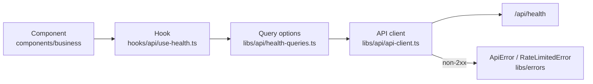
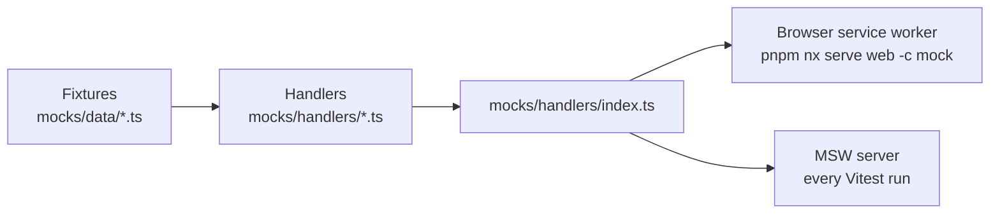

The dashboard (`apps/web`) is a React 19 single-page app built with Vite and styled with MUI. This page covers how it's built inside. Why React and MUI are in [Frontend framework](../../adrs/frontend-framework/) and [UI library](../../adrs/ui-library/).

## Structure

The source is split by **layer**, not by feature, and every layer holds one working example: start a feature by copying the example next to it. Why layers is in [Folder layout](../../adrs/folder-layout/).

```text
apps/web/src/
├── main.tsx                  # entry: providers and the mock-mode worker
├── app/
│   ├── app.tsx               # the root component (the health page today)
│   ├── app.spec.tsx
│   └── providers.tsx         # query client, theme, CssBaseline
├── components/
│   ├── business/             # tied to domain logic, e.g. health-status.tsx
│   └── ui/                   # presentational only, no domain coupling
├── hooks/
│   ├── api/                  # one-line query and mutation hooks, e.g. use-health.ts
│   └── ui/                   # hooks with no server state
├── contexts/                 # real cross-cutting state only (the future auth session)
├── libs/
│   ├── api/                  # API client and one module per resource
│   ├── errors/               # ApiError, RateLimitedError
│   ├── theme/                # MUI theme and the status palette
│   ├── test-utils/           # the app render helper (tests only)
│   ├── utils/                # shared helpers
│   └── observability/        # error tracking
├── mocks/
│   ├── data/                 # contract-typed fixtures, one file per resource
│   ├── handlers/             # MSW handlers, one file per resource, plus index.ts
│   └── node.ts               # MSW server for Vitest
└── test-setup.ts             # starts the MSW server for every test file
```

Some layers exist only on this page so far: `components/ui`, `hooks/ui`, `contexts`, `libs/utils` and `libs/observability`. A folder is created with its first real file, never as an empty placeholder.

Import across layers with the `@/` alias for `src/` (`import { api } from '@/libs/api/api-client'`). TypeScript resolves it from `tsconfig.app.json` and `tsconfig.spec.json`, and Vite and Vitest from `vite.config.mts`.

## Talking to the API

Server state lives in **TanStack Query**. Why is in [Server state](../../adrs/server-state/). A request passes through four layers, each with one job:



- **The API client** (`createApiClient`) has `get`, `post` and `patch`. Every call takes the response's Zod schema from the shared contracts and returns what the schema parsed, so no caller can name a response type it never checked. The API is a trust boundary for the browser too. One instance, `api`, is exported; the factory stays so a second API can build its own. Components and tests never swap the client: tests change what the network answers, with MSW.
- **Relative URLs.** The client's base URL is `/api`. In development Vite proxies `/api` to the API; in production both are served from one origin.
- **Errors are typed.** A non-2xx response throws an `ApiError` with its status and parsed body. A 429 whose body matches the contract becomes a `RateLimitedError`, carrying the message and `retryAt`, the time the user can try again. A 429 with a malformed body stays a plain `ApiError`. The client's `onError` option sees every failure; error tracking plugs in there.
- **Resource modules** (`libs/api/<resource>-queries.ts`) export the resource's query key as a constant (`healthQueryKey = ['health']`), the plain calls, and a query-options factory (`healthQueries.status()` builds the full `queryOptions` on that key). Fetching, prefetching and invalidation (`queryClient.invalidateQueries({ queryKey: healthQueryKey })`) all import the same constant, so a key is never retyped as a string.
- **Hooks** are one line: `useHealth = () => useQuery(healthQueries.status())`. Components never fetch directly.
- **No automatic retries or focus refetches.** Against a rate-limited API every extra request spends the user's allowance, so a query fails at once and shows its error, and returning to the tab doesn't fetch again. Live data will arrive over the realtime connection instead.
- **Lint.** `@tanstack/eslint-plugin-query` checks query keys against the query function's inputs and catches unstable query clients.

## No `useEffect`

Components never call `useEffect`, and lint fails if they do. Most effects are a workaround for something with a better tool: derive values during render, do work in event handlers, fetch through a `hooks/api` hook, and reset a component with a `key`. React's own guide, [You Might Not Need an Effect](https://react.dev/learn/you-might-not-need-an-effect), explains each one. The rare real sync with an outside system on mount, such as focusing an element or subscribing to a browser API, goes through a `useMountEffect` hook in `hooks/ui/`, the one place allowed to call `useEffect`.

## Styling

Components use MUI and style with the `sx` prop and theme tokens, never separate CSS files. The theme is in `libs/theme/theme.ts`. Besides MUI's defaults, its palette has `palette.status.ok`, `.warning` and `.exceeded`, one colour for each rate-limit status, so every screen shows a status the same way.

## API mocking

The dashboard can run without the API. **Mock Service Worker (MSW) 3** answers API requests from handlers typed with the shared contracts. Each resource has its own fixtures in `mocks/data/` and handlers in `mocks/handlers/`, and `mocks/handlers/index.ts` combines them for both users:



- **Mock mode** (`pnpm nx serve web -c mock`) starts the app with a service worker. Build UI before its endpoint exists by adding a fixture and a handler first. The worker script is served by MSW's Vite plugin in development only, so it's neither committed nor shipped.
- **Component tests** run against the same handlers. A test overrides one with `server.use(...)` to simulate an error. Any request without a handler fails the test.

Because MSW intercepts at the network level, the app runs its real client in both cases: fetching, contract parsing and error mapping. End-to-end tests never use MSW.

**Realtime events** won't go through MSW: the MSW binding for Socket.IO doesn't support MSW 3 yet. The app will reach the realtime connection through one client module, which tests replace with `vi.mock` and mock mode swaps for a fake that emits contract-typed events.

## Testing

Component tests use Vitest, Testing Library and MSW, through one helper: `renderApp()` in `libs/test-utils/render-app.tsx` mounts the real app with its real providers and a fresh query cache. A test renders the app, then asserts what the user sees and can do (roles, accessible names, text), never hooks, query keys or client internals:

```tsx
it('shows an error when the API is unreachable', async () => {
  server.use(
    http.get('/api/health', () => new HttpResponse(null, { status: 503 })),
  );

  renderApp();

  expect(await screen.findByText('API unreachable')).toBeTruthy();
});
```

The dashboard is also covered end to end by the `web` Playwright suite, which uses page objects.

## Decisions to make

These are open and will be decided with the first feature that needs them; each gets an ADR and a row in the [decision log](../../adrs/architecture-decisions/#decision-log).

- **Client state:** whether anything beyond server state and URL state needs a store.
- **Routing:** a router library, decided with the second page.

Decided: folder layout ([Folder layout](../../adrs/folder-layout/)) and server state ([Server state](../../adrs/server-state/)).
