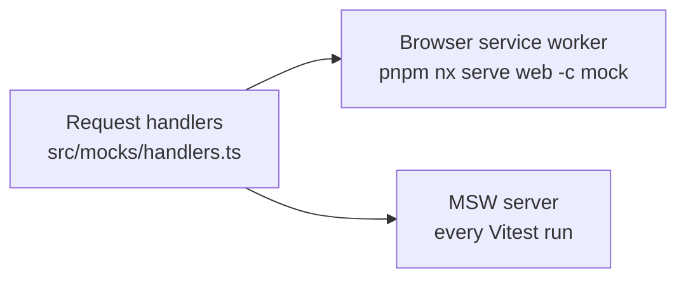

The dashboard (`apps/web`) is a React 19 single-page app built with Vite and styled with MUI. This page covers how it's built inside. Why React and MUI are in [Frontend framework](../../adrs/frontend-framework/) and [UI library](../../adrs/ui-library/).

## Structure

```text
apps/web/src/
├── main.tsx          # entry: MUI theme, CssBaseline, mock-mode worker
├── app/
│   ├── app.tsx       # the health page
│   └── app.spec.tsx
├── mocks/
│   ├── handlers.ts   # API mocks shared by dev and tests
│   └── node.ts       # MSW server for Vitest
└── test-setup.ts     # starts the MSW server for every test file
```

## Talking to the API

- Calls use relative `/api/...` URLs. In development Vite proxies `/api` to the API; in production both are served from one origin.
- Every response is parsed with its schema from the shared contracts (`schema.parse(await res.json())`), never cast. The API is a trust boundary for the browser too.
- Today the one page fetches in a `useEffect`. A data-fetching library is an open decision (below).

## Styling

Components use MUI and style with the `sx` prop and theme tokens, never separate CSS files. The theme is set once in `main.tsx`.

## API mocking

The dashboard can run without the API. **Mock Service Worker (MSW) 3** answers API requests from one set of handlers in `src/mocks/handlers.ts`, typed with the shared contracts, in two places:



- **Mock mode** (`pnpm nx serve web -c mock`) starts the app with a service worker. Build UI before its endpoint exists by adding a handler first. The worker script is served by MSW's Vite plugin in development only, so it's neither committed nor shipped.
- **Component tests** run against the same handlers. A test overrides one with `server.use(...)` to simulate an error. Any request without a handler fails the test.

Because MSW intercepts at the network level, the app runs its real `fetch` code in both cases. End-to-end tests never use MSW.

**Realtime events** won't go through MSW: the MSW binding for Socket.IO doesn't support MSW 3 yet. The app will reach the realtime connection through one client module, which tests replace with `vi.mock` and mock mode swaps for a fake that emits contract-typed events.

## Testing

Component tests use Vitest, Testing Library and MSW; they assert what the user sees (roles and text). The dashboard is also covered end to end by the `web` Playwright suite, which uses page objects.

## Decisions to make

These are open and will be decided with the first feature that needs them; each gets an ADR and a row in the [decision log](../../adrs/architecture-decisions/#decision-log).

- **Server state and data fetching:** for example TanStack Query, versus plain `fetch` in hooks. Decided with the live user table, which needs caching and live updates.
- **Client state:** whether anything beyond server state and URL state needs a store.
- **Folder layout:** feature folders (`features/users/…`) versus layers (`components/`, `hooks/`). Decided when the second page arrives.
- **Routing:** a router library, decided with the second page.
