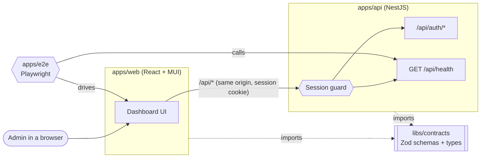
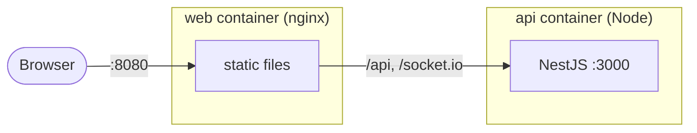

ratewatch is a TypeScript monorepo with two applications, a shared library of contracts, and an end-to-end test suite. This page describes the system as it stands today; it grows as features land. How each app is built inside is in [Backend architecture](../backend/) and [Frontend architecture](../frontend/).

## Parts

**Web app (`apps/web`).** A React single-page app built with Vite and styled with MUI. It calls the API with relative `/api/...` URLs: in development Vite proxies them to the API, and in production nginx serves the built files and forwards `/api` and `/socket.io` to the API, so the browser sees one origin and never needs CORS. See [Same origin through nginx](../../adrs/same-origin/). Every response is parsed with its contract before the UI uses it.

**API (`apps/api`).** A NestJS service under the `/api` prefix. Today it exposes a health endpoint and sign-in; rate limiting arrives as an interceptor with the rate-limiting feature.

### Authentication

A person signs in as a User (a new random user ID each time) or as the Admin, with no password. The API answers with a session (user ID, role, expiry) in a signed, `httpOnly`, `SameSite=Strict` cookie that lasts 24 hours from sign-in. A global guard checks the signature and expiry on every request and answers 401 without a valid session; only sign-in, sign-out and health are public. Handlers read the signed-in person from the request, which is where the rate limiter will take its user ID. The web app restores the session on load from `GET /api/auth/me` and sends anyone without one to the sign-in page. See [Identity and roles](../../adrs/identity-and-roles/).

**Contracts (`libs/contracts`).** Zod schemas for every shape the two apps exchange, each with its inferred TypeScript type. See [API contracts](../../adrs/api-contracts/).

### End-to-end tests

`apps/e2e` (the Nx project `ratewatch-e2e`) is one Playwright suite that starts the real API and web app and tests them together, because ratewatch's core flows cross both apps. It has two suites: `api` calls the API directly with no browser, and `web` drives Chromium through page objects. Nx starts both servers before the run, and CI runs the suite on every pull request that affects either app.

## Repository

Everything lives in one repository: the apps, the contracts library, the end-to-end suite and this wiki. pnpm workspaces link the packages, and Nx runs the tasks on top:

- **`affected` runs:** CI only lints, tests and builds what a pull request could have changed.
- **Task caching:** a task whose inputs haven't changed is replayed from cache.
- **Import boundaries:** every project carries a `scope:*` tag, and a lint rule rejects imports across boundaries, such as the web app importing API code, or the contracts library importing either app.

A change to a shared shape, and the updates to both apps that consume it, land in one pull request. Why Nx and the options we weighed are in [Monorepo](../../adrs/monorepo/).

## Containers

Each app has one Dockerfile with two targets. `dev` runs the app's dev server with hot reload, and is what `docker compose up --watch` starts. `prod`, the default, holds only what runs in production: the API's bundle and production dependencies on a slim Node image, and the dashboard's static files on nginx. Both run as non-root users. See [Local environment](../../adrs/local-environment/) and [Running locally](../../guides/running-locally/).

## Not here yet

The rate-limit store, the rate-limiting interceptor, realtime updates, admin-only access and Kubernetes deployment each arrive with the feature that needs them, along with their ADRs and an update to this page. See the [decision log](../../adrs/architecture-decisions/#decision-log) for what's proposed.
