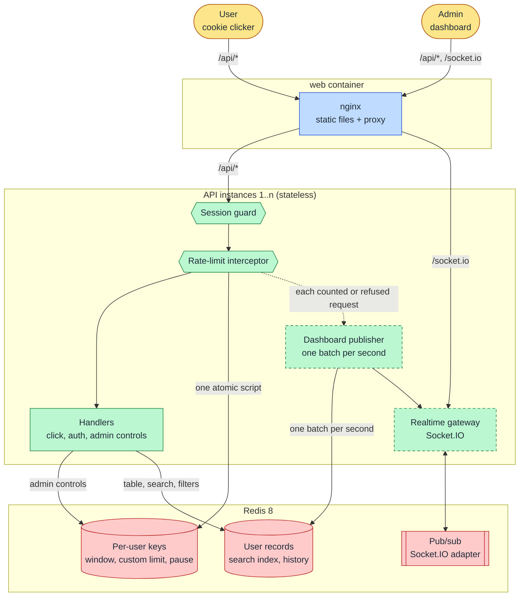
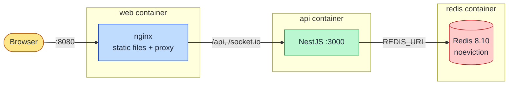
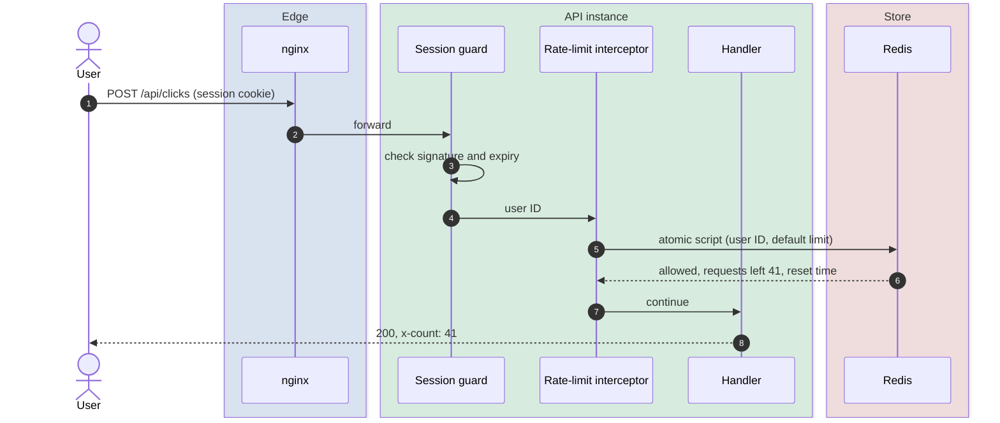
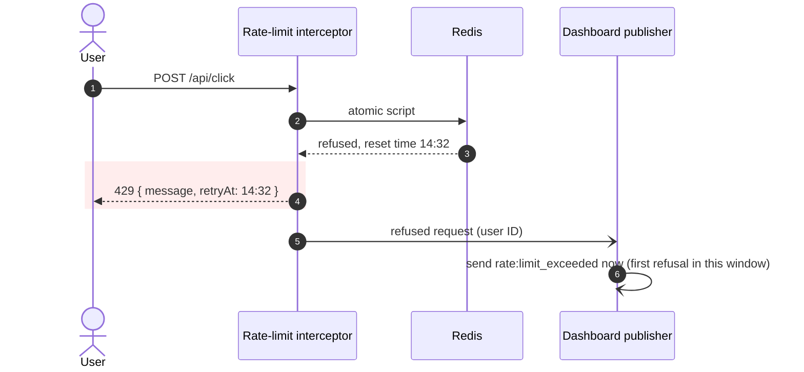
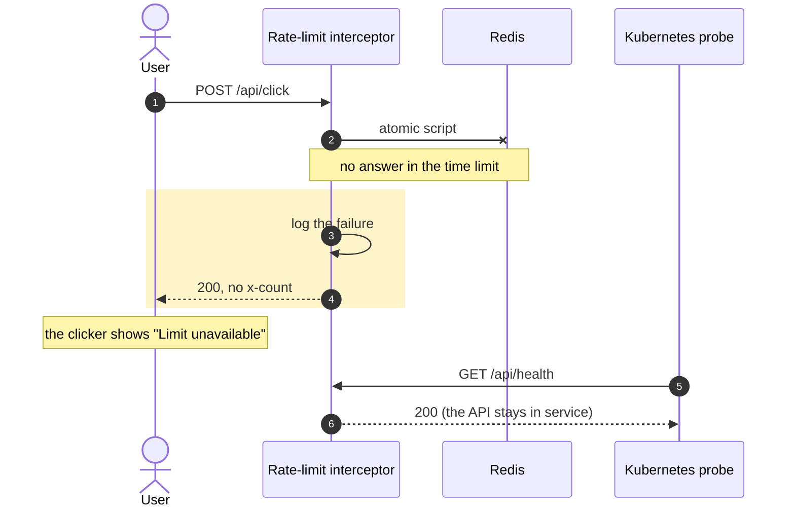
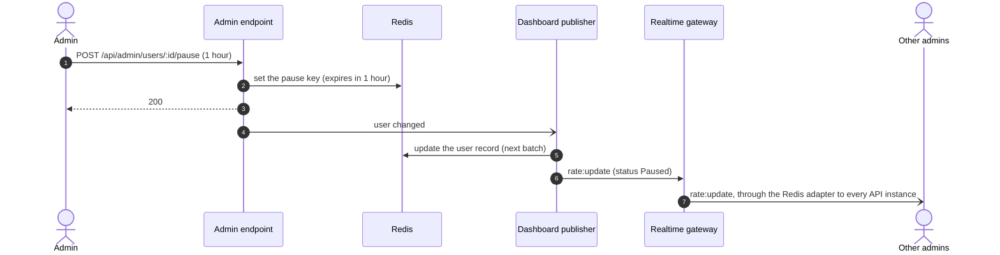
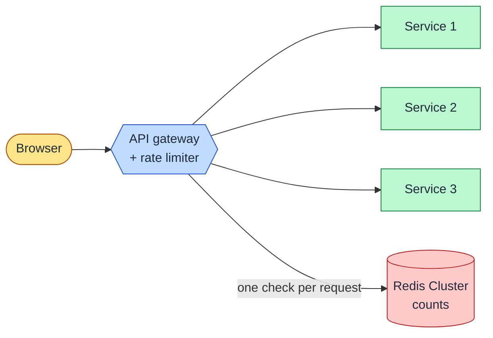

ratewatch limits how many requests each user can send in one hour, and shows admins each user's usage live. This page describes the full system in five steps: the use cases and numbers, the high-level design, the core components, how the design scales, and what we measure. Parts that are not built yet show the label **Planned**.

How each app works inside is in [Backend architecture](../backend/) and [Frontend architecture](../frontend/). Why we made each decision is in the [decision log](../../adrs/architecture-decisions/#decision-log).

## Step 1: Use cases, constraints and assumptions

### Use cases

- A **User** sends requests (the cookie clicker sends one request for each click). Each successful response tells the user their **requests left**.
- A User over their **limit** gets a "too many requests" response with a message and their **reset time**.
- An **Admin** watches all users in a live table. The admin searches, filters and sorts it, and opens one user for details and history.
- An Admin changes one user's limit: **reset limit**, **custom limit**, **extra requests**, **pause** and **unlock**.
- An Admin sees summary numbers: total users, users near their limit, refused requests today, and the top users in the current window.

Out of scope: limits for each endpoint or plan, billing, history older than 24 hours.

### Constraints

These rules are fixed. Every design on this page obeys them.

| Rule                  | What it means                                                                                                |
| --------------------- | ------------------------------------------------------------------------------------------------------------ |
| Limit                 | 100 requests per user per hour, unless an admin sets a custom limit.                                         |
| Who counts            | The user ID from the session. Never the IP address or the device.                                            |
| Where the check runs  | A NestJS interceptor in the API.                                                                             |
| Where the count lives | An external store (Redis), shared by all API instances.                                                      |
| Concurrent requests   | Exactly the limit succeeds, never more, also when many requests arrive at the same time.                     |
| Successful response   | Has the header `x-count`: the requests left.                                                                 |
| Refused response      | HTTP 429 with a message and the time the user can try again.                                                 |
| Live updates          | `@nestjs/websockets`, with the events `rate:update` and `rate:limit_exceeded`.                               |
| Store failure         | The API keeps serving (fail open). It sends no `x-count` and logs the failure. Its health check stays green. |

### Assumptions and estimates

The numbers below are design targets, not measurements. The load test checks them.

| Question                | Assumption                                                                                                                                                        |
| ----------------------- | ----------------------------------------------------------------------------------------------------------------------------------------------------------------- |
| Users                   | Today: tens (the traffic simulator signs in about 20). Design target: 1,000,000 active users in one hour.                                                         |
| Admins                  | Fewer than 10 at the same time.                                                                                                                                   |
| Requests per second     | Allowed requests are at most users × limit: 1,000,000 × 100 per hour, about 28,000 per second. We plan for 100,000 per second at peak, refused requests included. |
| Store calls per request | One. A single atomic script does the check and the count.                                                                                                         |
| Data per user           | Less than 1 KB (counts, user record, 24 hours of history). 1,000,000 users need less than 1 GB of memory.                                                         |
| Read to write ratio     | The limiter writes on almost every request. The dashboard reads only when an admin loads or filters the table. So the store is write-heavy.                       |
| Response time           | At up to 100,000 requests per second, the limit check takes less than 1 ms for half of requests (p50) and less than 5 ms for 99% (p99). Step 5 measures it.       |

Because the store is write-heavy, small and fast, it lives in memory (Redis), not in a database.

## Step 2: High-level design

Dashed boxes are **Planned**.

- **Web app** (`apps/web`): React, Vite and MUI. It calls the API with relative `/api/...` URLs and parses each response with its contract before the UI uses it. It starts the Admin on the dashboard and a User on the cookie clicker.
- **nginx** serves the web app and sends `/api` and `/socket.io` to the API. The browser sees one origin, so there is no CORS. See [Same origin through nginx](../../adrs/same-origin/).
- **API instances** keep no state in memory. Any instance can serve any request, so we add instances to add capacity.
- **Redis** keeps all shared state: the counts, the dashboard data, and the messages between API instances.
- **Contracts** (`libs/contracts`) are Zod schemas for every shape that the web app and the API exchange. Both apps validate with them. See [API contracts](../../adrs/api-contracts/).

### Containers

Each app runs in its own container, and Redis in a third. Compose runs them locally and in CI; the production-like run publishes only nginx, and Redis needs a password. See [Running locally](../../guides/running-locally/).

### Flows

**An allowed request.** The user has requests left.

**A refused request.** The user has no requests left. The store writes nothing, so a refused request does not use up the limit.

**Redis is down (fail open).** The request continues without a count.

**An admin pauses a user, and every admin sees it live.**

## Step 3: Core components

### Session guard (built)

A person signs in as a User (a new random user ID each time) or as the Admin, with no password. The API sends the **session** (user ID, role, end time) in a signed cookie. The cookie is `httpOnly` and `SameSite=Strict`, and it lasts 24 hours.

A global guard checks the signature and the end time on each request. It answers 401 when the session is not valid. Only sign-in, sign-out and health are public. Endpoints for one role answer 403 to other roles. The guard needs no store, so a request without a valid session costs no Redis call. See [Identity and roles](../../adrs/identity-and-roles/).

### Rate-limit interceptor (built)

The interceptor runs after the guard, so it knows the user ID. It skips public endpoints and all Admin requests.

**Algorithm: a fixed window that starts at the first request.** The first request of a user opens a **window** of one hour. The user can send up to their limit in that window. When the window ends, the count starts again from zero.

**Keys in Redis.** All keys for one user contain the user ID in braces, for example `rl:{user-3f9a1c2e}:window`. Redis Cluster puts keys with the same braces on the same shard, so one script can use all of them.

| Key          | Holds                            | Expires                                          |
| ------------ | -------------------------------- | ------------------------------------------------ |
| Window       | The count and the extra requests | One hour after the first request: the reset time |
| Custom limit | The custom limit                 | Never (an admin removes it)                      |
| Pause        | That the limit is paused         | When the pause ends                              |

**One atomic script for each request.** Redis runs a Lua script as one step, so two requests can never both pass the check for the last request left. The script:

1. Reads the pause, the custom limit (or 100) and the window.
2. If the user is not paused and has no requests left: returns "refused" and the reset time. It writes nothing.
3. Else: adds 1 to the count. If this request opened the window, it sets the expiry to one hour.
4. Returns the requests left and the reset time.

The script sets the expiry one time only, when the window opens. A new expiry on each request would move the reset time later and later.

### Failure mode (built)

Redis can stop or be slow. Then the API **fails open**: the request continues without `x-count`. Each Redis call has a short time limit (about 50 ms, 10 times the p99 target; the load test sets the final value) and no retry, so a slow Redis does not make requests slow. The API logs when Redis goes down and comes back, and while it's down, at most one line every 10 seconds saying requests go through uncounted. How many went through uncounted is a metric (Step 5). `GET /api/health` never checks Redis: a check that failed with Redis would take every API instance out of service at once, the full outage that failing open avoids. The web app shows "Limit unavailable" when `x-count` is missing.

Showing "Limit unavailable" to the user is a product decision. Most products hide a failure like this from the user. In ratewatch, the limit is the product, so the user must know when we cannot count their requests. The other choices: hide the count, keep the last count, or count in the memory of each API instance. Each one shows a number that is wrong, or hides that the limit does not apply.

We accept that a user can send more than their limit while Redis is down. The other choice, fail closed, refuses all requests during the failure, so a store failure stops the whole product.

### Dashboard data (Planned)

The limiter does not write dashboard data on the request path. Each API instance keeps the latest numbers for each user in memory. One time each second, it writes them to Redis in one batch. One batch per second replaces one write for each request.

- **User record**: one Redis hash for each user, with the limit, the count, the reset time, the pause end and the last request. It keeps numbers only. The **status** (OK, Warning, Exceeded or Paused) comes from these numbers and the current time when the API reads them, so a window that ended never shows a stale status.
- **Search index**: the Redis 8 query engine indexes the user records. One query does search by user ID, filters, sort by one column, a page of up to 100 rows, and the count for each status.
- **History**: accepted and refused requests for the past hour and day, kept 24 hours.
- **Refused requests today**: one counter for each UTC day. It expires at the end of the day.

### Realtime delivery (Planned)

The API sends live updates with `@nestjs/websockets` and Socket.IO. The Socket.IO Redis adapter passes each event to all API instances, so an admin on any instance gets it. Only the Admin can connect: the handshake checks the session cookie.

- **Rooms.** An admin joins one room for each row on screen and one for the open user. A room for all admins gets the summary numbers and the counts for each status. An admin gets events only for what they see, so the number of events does not grow with the number of users.
- **`rate:update`**: at most one each second for each user, with the latest numbers. If an admin is disconnected, the event is dropped, because a newer one follows.
- **`rate:limit_exceeded`**: sent at once, one time for each user in each window.
- **Reconnect**: the web app loads the data again, then continues with live events.

### Admin controls (Planned)

Admin endpoints accept the Admin role only. Each one changes the user's keys in Redis, then tells the dashboard publisher.

| Control        | Change in Redis                                            |
| -------------- | ---------------------------------------------------------- |
| Reset limit    | Deletes the window. The next request opens a new one.      |
| Custom limit   | Sets the custom limit key.                                 |
| Extra requests | Adds to the window. They end with the window.              |
| Pause          | Sets the pause key, which expires at the end of the pause. |
| Unlock         | Deletes the pause key.                                     |

## Step 4: Scale the design

### Bottlenecks and fixes

| Bottleneck                                   | Fix                                                                                                                                        | Trade-off                                                                                                      |
| -------------------------------------------- | ------------------------------------------------------------------------------------------------------------------------------------------ | -------------------------------------------------------------------------------------------------------------- |
| API CPU                                      | More API instances. In Kubernetes, the Helm chart's autoscaler adds pods when load goes up.                                                | None for the limit: the count is in Redis, so the limit is the same on every instance.                         |
| Redis throughput                             | Redis Cluster: several primaries, each with a part of the users. The braces in the keys keep one user on one shard.                        | More nodes to run. One script can use the keys of one user only.                                               |
| Redis availability                           | Replicas with Sentinel (or a managed Redis). A replica becomes the primary when the primary fails.                                         | Replication is asynchronous, so a failover can lose the last counts. A user can then get a few extra requests. |
| Requests from users who are already Exceeded | Each API instance remembers "refused until the reset time" and answers 429 without a Redis call. Add it when the load test shows the need. | An admin change (extra requests, pause, reset limit) must clear that memory on all instances, through pub/sub. |
| Dashboard writes                             | One batch per instance per second, not one write for each request.                                                                         | The dashboard can be up to one second behind.                                                                  |
| Live events to admins                        | Rooms for the rows on screen, and at most one `rate:update` each second for each user.                                                     | An admin does not see live changes for rows on other pages until they open them.                               |
| Floods and denial of service                 | In front of the system: a CDN or the Kubernetes gateway, with limits per IP and per connection.                                            | Out of scope for the limiter, which counts per user ID only.                                                   |

The per-user limit protects fair use. It does not stop a flood. A flood without a valid session ends at the session guard, with no Redis call. A flood of sign-ins is a different case: each demo sign-in makes a new user with a new limit. Real accounts close that gap.

### The limiter in a system with many services

A large system with many services often puts the limiter in the API gateway, in front of all services:

That design is good when:

- many services must share one limit, and
- the gateway can identify the user by itself, for example with a signed token that it can verify, and
- refused requests must never reach the services.

ratewatch has one service, and only the API can verify the session cookie. A limiter in the gateway would need a second copy of the session check and of the limit rules (custom limit, extra requests, pause). Two places would then decide the limit, and they could disagree. The gateway also calls Redis one time for each request, so it does not decrease the load on Redis. So the limiter stays in the API. We change this when a second service needs the same limit.

### Trade-offs of the main decisions

The full trade-offs are in [Rate-limit store and window](../../adrs/rate-limit-store/), [Failure mode](../../adrs/failure-mode/), [Dashboard data](../../adrs/dashboard-data/), [Realtime delivery](../../adrs/realtime-delivery/) and [Redis client](../../adrs/redis-client/). The keys, scripts, endpoints and events are in the [rate limiting and live dashboard design doc](../../design-docs/rate-limiting-and-live-dashboard/).

| Decision             | We chose                                   | Other options                                              | Why                                                                                             | Cost                                                                                     |
| -------------------- | ------------------------------------------ | ---------------------------------------------------------- | ----------------------------------------------------------------------------------------------- | ---------------------------------------------------------------------------------------- |
| Where the check runs | Interceptor in each API instance           | API gateway; a separate limiter service                    | Only the API knows the user ID and the admin controls. The shared store makes the limit global. | Refused requests reach the API.                                                          |
| Algorithm            | Fixed window from the first request        | Window on the clock hour; sliding window; token bucket     | Gives "requests left" and a reset time, as the product needs. One small key for each user.      | A user can send their limit at the end of one window and again at the start of the next. |
| Store                | Redis                                      | A database; memory of each API instance                    | Fast atomic scripts, shared by all instances. Keys expire by themselves.                        | Data is in memory. A failover can lose the last counts.                                  |
| Store failure        | Fail open                                  | Fail closed                                                | A store failure does not stop the product.                                                      | No limit during the failure.                                                             |
| Dashboard reads      | Redis 8 query engine on user records       | Sorted sets for each column; load all users in the browser | One query does search, filters, sort, pages and counts. No index code to maintain.              | Redis 8 licence (RSALv2, SSPLv1 or AGPLv3). Each write updates the index.                |
| Realtime             | Socket.IO with the Redis adapter, in rooms | Plain WebSockets; server-sent events; polling              | Reconnect, rooms and events across instances are built in.                                      | Sticky sessions when there are many instances.                                           |

## Step 5: Measure

Each number in Step 1 is a target. We measure each one, so we know when a target fails and which fix in Step 4 to use next. The API and Redis export these metrics to a dashboard (Grafana, with the observability work). We use percentiles, not averages: p95 and p99 show the slow requests that an average hides.

A time target is true only up to a request rate. "p99 less than 5 ms" means: 99 of 100 limit checks take less than 5 ms, **while the system serves up to 100,000 requests per second** (the peak in Step 1). Above that rate, requests wait in queues and the time goes up. So each time target below applies at that peak, and the load test checks both together. We read each percentile over the last 5 minutes.

### Rate limiter

| Metric                                                   | Why we measure it                                                                                   | Target or alert                                                                                                          |
| -------------------------------------------------------- | --------------------------------------------------------------------------------------------------- | ------------------------------------------------------------------------------------------------------------------------ |
| Limit check time, p50, p95 and p99                       | The time the interceptor waits for the atomic script. It is added to each limited request.          | p50 less than 1 ms, p99 less than 5 ms. Warning when p99 is more than 10 ms for 5 minutes, critical when more than 50 ms |
| Decisions per second: allowed, refused, failed open      | Shows the traffic, the share of refused requests, and each request that went through with no limit. | Alert when failed open is more than 0 for 1 minute                                                                       |
| Redis errors and time-outs per second                    | The cause of failed open requests.                                                                  | Alert when more than 0 for 1 minute                                                                                      |
| Redis connection                                         | The "Redis unavailable" and "Redis is back" log lines: when the limit stopped and started applying. | Alert on "Redis unavailable"                                                                                             |
| Refused without a Redis call (when that memory is added) | Shows how many Redis calls the "refused until the reset time" memory saves.                         | No target                                                                                                                |

### API

| Metric                                          | Why we measure it                                                                      | Target or alert                            |
| ----------------------------------------------- | -------------------------------------------------------------------------------------- | ------------------------------------------ |
| Requests per second, for each route and status  | Load, and the share of 2xx, 401, 429 and 5xx responses.                                | Alert when 5xx is more than 1%             |
| Response time, p50, p95 and p99, for each route | The full time the user waits. Compare with the limit check time to find the slow part. | No fixed target yet; the load test sets it |
| CPU and memory for each instance                | Tells the autoscaler when to add instances.                                            | Scale out at 70% CPU                       |

### Redis

| Metric                                | Why we measure it                                                                            | Target or alert               |
| ------------------------------------- | -------------------------------------------------------------------------------------------- | ----------------------------- |
| Commands per second and CPU           | One Redis process uses one CPU core for commands. Near the limit, we add shards.             | Alert at 70% CPU              |
| Script time (`evalsha`), p99          | The atomic script blocks Redis while it runs, so it must stay short.                         | p99 less than 1 ms            |
| Memory used, against the memory limit | When memory is full, Redis refuses writes.                                                   | Alert at 80%                  |
| Evicted keys                          | Redis must never delete a key to free memory: a deleted key loses a custom limit or a pause. | Alert when more than 0        |
| Replication lag (with replicas)       | The counts that a failover can lose.                                                         | Alert when more than 1 second |
| Number of keys                        | Shows the active users, and that keys expire.                                                | No target                     |

### Dashboard and realtime

| Metric                                        | Why we measure it                                                                    | Target or alert             |
| --------------------------------------------- | ------------------------------------------------------------------------------------ | --------------------------- |
| Time from a request to its `rate:update`, p95 | How far the dashboard is behind the users.                                           | p95 less than 2 seconds     |
| Batch size and batch write time               | The number of users that each instance writes in each second, and the time it takes. | Write time less than 100 ms |
| Table query time, p95 and p99                 | The time to search, filter, sort and count on the query engine.                      | p99 less than 100 ms        |
| Connected admins, and events sent per second  | The load on Socket.IO and the Redis adapter.                                         | No target                   |

### Load test

The load test sends traffic to the full stack and fails when a target fails. It checks two more things that the dashboard cannot show:

- **No request slips through:** for each user, the allowed requests in one window are never more than the limit.
- **Refused requests do not count:** after the window ends, each user gets a full limit again.

How the apps are built, tested and run is in [Monorepo](../../adrs/monorepo/), [End-to-end tests](../../adrs/end-to-end-tests/), [Local environment](../../adrs/local-environment/) and [Running locally](../../guides/running-locally/).
