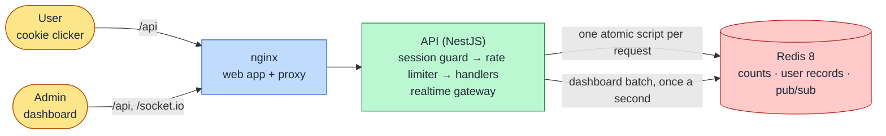
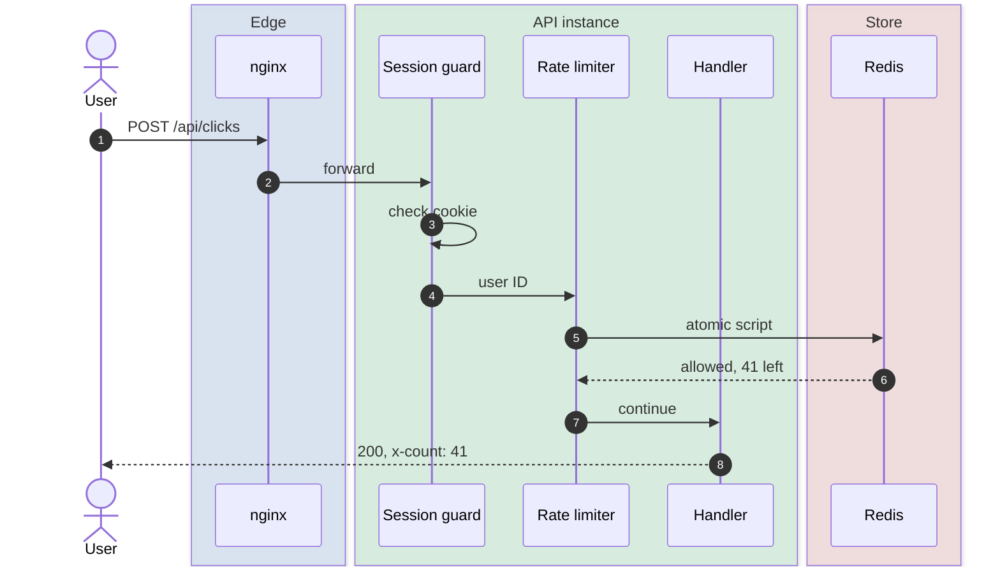
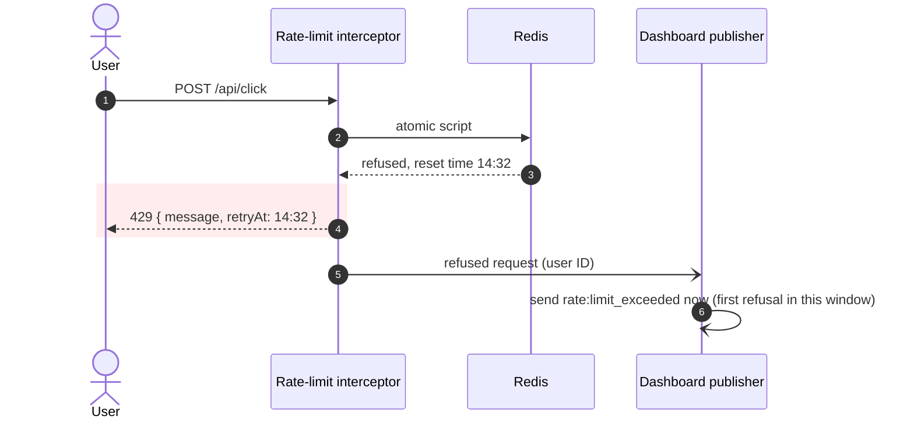
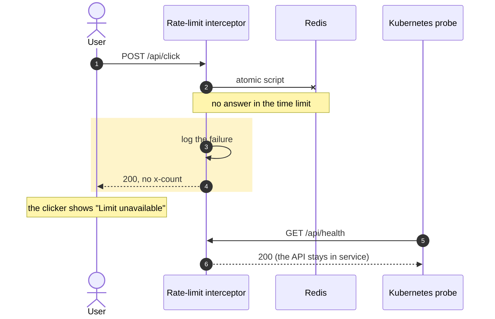
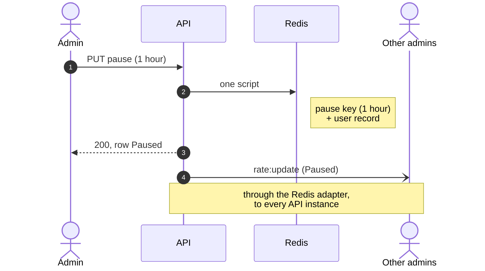
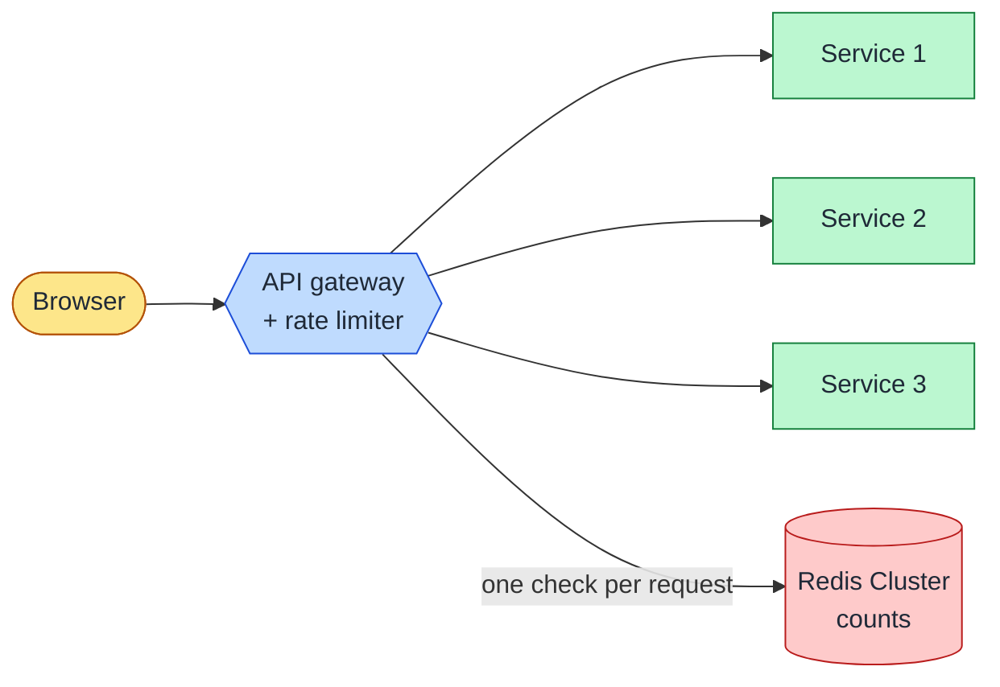

ratewatch limits how many requests each user can send in one hour, and shows admins each user's usage live. This page goes through the requirements, the high-level design, the core components, the trade-offs, how the design scales, and what we measure.

How each app works inside is in [Backend architecture](../backend/) and [Frontend architecture](../frontend/). Why we made each decision is in the [decision log](../../adrs/architecture-decisions/#decision-log).

## Step 1: Requirements

### Use cases

- A **User** sends requests (the cookie clicker sends one for each click). Each successful response tells the user their **requests left**; a User over their **limit** gets "too many requests" with their **reset time**.
- An **Admin** watches all users in a live table: search, filter, sort, and open one user for details and history.
- An Admin changes one user's limit: **reset limit**, **custom limit**, **extra requests**, **pause** and **unlock**, and sees summary numbers.

Out of scope: limits for each endpoint or plan, billing, history older than 24 hours.

### Constraints

| Rule                  | What it means                                                                                                |
| --------------------- | ------------------------------------------------------------------------------------------------------------ |
| Limit                 | 100 requests per user per hour, unless an admin sets a custom limit.                                         |
| Who counts            | The user ID from the session. Never the IP address or the device.                                            |
| Where the check runs  | A NestJS interceptor in the API.                                                                             |
| Where the count lives | An external store (Redis), shared by all API instances.                                                      |
| Concurrent requests   | Exactly the limit succeeds, never more, also when many requests arrive at the same time.                     |
| Successful response   | Has the header `x-count`: the requests left.                                                                 |
| Refused response      | HTTP 429 with a message and the time the user can try again.                                                 |
| Live updates          | `@nestjs/websockets`, with the events `rate:update` and `rate:limit_exceeded`.                               |
| Store failure         | The API keeps serving (fail open). It sends no `x-count` and logs the failure. Its health check stays green. |

### Estimates

The numbers below are design targets, not measurements. The load test checks them.

| Question                | Assumption                                                                                                                                                                                                                                                                                                                      |
| ----------------------- | ------------------------------------------------------------------------------------------------------------------------------------------------------------------------------------------------------------------------------------------------------------------------------------------------------------------------------- |
| Users                   | 100,000 active users in the peak hour. Fewer than 10 admins at the same time.                                                                                                                                                                                                                                                   |
| Requests per second     | Allowed requests are at most users × limit: 100,000 × 100 per hour, about 2,800 per second. We plan for 10,000 per second at peak, refused requests and bursts included.                                                                                                                                                        |
| Why this target         | One Redis primary runs a short Lua script tens of thousands of times a second on one core, so 10,000 per second fits one primary with a replica, with headroom. Above that, Step 5 adds Redis Cluster. The load test checks latency at realistic load; finding the real capacity needs a ramp test on production-like hardware. |
| Store calls per request | One. A single atomic script does the check and the count.                                                                                                                                                                                                                                                                       |
| Read to write ratio     | The limiter writes on almost every request; the dashboard reads only when an admin loads or filters the table. The store is write-heavy.                                                                                                                                                                                        |
| Response time           | At up to 10,000 requests per second, the limit check takes less than 1 ms at p50 and less than 5 ms at p99.                                                                                                                                                                                                                     |

The store is write-heavy and every check must be atomic and take under a millisecond, so it lives in memory (Redis), not in a database.

## Step 2: High-level design

- **Web app** (`apps/web`): React, Vite and MUI. It calls the API with relative `/api/...` URLs and parses each response with its contract.
- **nginx** serves the web app and sends `/api` and `/socket.io` to the API. The browser sees one origin, so there is no CORS. See [Same origin through nginx](../../adrs/same-origin/).
- **API** keeps no state in memory, so we can run more copies of it behind the load balancer to add capacity.
- **Redis** keeps all shared state: the counts, the dashboard data, and the messages between API instances.
- **Contracts** (`libs/contracts`) are Zod schemas for every shape the web app and the API exchange. See [API contracts](../../adrs/api-contracts/).

Each part runs in its own container; see [Running locally](../../guides/running-locally/).

### Flows

**An allowed request.** The user has requests left.

The request carries the session cookie; the guard checks its signature and expiry. The script gets the user ID and the default limit, and also answers the reset time.

**A refused request.** The user has no requests left. The store writes nothing, so a refused request does not use up the limit.

**Redis is down (fail open).** The request continues without a count.

**An admin pauses a user, and every admin sees it live.**

The API's admin endpoint is `PUT /api/admin/users/:id/pause`. It sends the new row to the realtime gateway at once, without waiting for the publisher's next batch.

## Step 3: Core components

### Session guard

A person signs in as a User (a new random user ID each time) or as the Admin, with no password. The session (user ID, role, end time) lives in a signed, `httpOnly`, `SameSite=Strict` cookie that lasts 24 hours. A global guard checks it on each request: 401 when it's not valid, 403 for the wrong role. It needs no store, so a request without a valid session costs no Redis call. See [Identity and roles](../../adrs/identity-and-roles/).

### Rate-limit interceptor

The interceptor runs after the guard, so it knows the user ID. It applies only to clicks (`POST /api/clicks`), so a user over the limit can still open the app, and it skips Admin requests.

**Algorithm: a fixed window that starts at the first request, with a token bucket on top.** The first request of a user opens a **window** of one hour. The user can send up to their limit in that window. When the window ends, the count starts again from zero. A token bucket, the **burst limit**, also caps how fast requests can arrive.

**Keys in Redis.** All keys for one user contain the user ID in braces, for example `rl:{user-3f9a1c2e}:window`. Redis Cluster puts keys with the same braces on the same shard, so one script can use all of them.

| Key          | Holds                                                      | Expires                                          |
| ------------ | ---------------------------------------------------------- | ------------------------------------------------ |
| Window       | The count, the extra requests and the burst limit's tokens | One hour after the first request: the reset time |
| Custom limit | The custom limit                                           | Never (an admin removes it)                      |
| Pause        | That the limit is paused                                   | When the pause ends                              |

**One atomic script for each request.** Redis runs a Lua script as one step, so two requests can never both pass the check for the last request left. The script:

1. Reads the pause, the custom limit (or 100) and the window.
2. If the user is not paused and has no requests left: returns "refused" and the reset time. It writes nothing.
3. Refills the burst limit's bucket, even for a paused user, for the time since its last spend. With no token left, it returns "too fast" and the time of the next token. It writes nothing.
4. Else: spends a token and adds 1 to the count. If this request opened the window, it sets the expiry to one hour.
5. Returns the requests left and the reset time.

The script sets the expiry one time only, when the window opens. A new expiry on each request would move the reset time later and later.

**Burst limit.** The window decides how many requests a user gets each hour; the bucket decides how fast they can arrive. It holds 20 tokens and gets 5 back each second, so a person clicking is never refused, while 100 requests sent at once spend only 20 of the hour. See [Burst limit](../../adrs/burst-limit/).

### Failure mode

When Redis stops or is slow, the API **fails open**: the request continues without `x-count`, and the web app shows "Limit unavailable". Each Redis call has a short time limit (about 50 ms, 10 times the p99 target) and no retry, so a slow Redis does not make requests slow. The API logs when Redis goes down and comes back. `GET /api/health` never checks Redis: a failing check would take every API instance out of service at once, the full outage that failing open avoids. We show "Limit unavailable" because in ratewatch the limit is the product, so the user must know when we cannot count. We accept that a user can send more than their limit while Redis is down; failing closed would stop the whole product.

### Dashboard data and realtime

- **No dashboard writes on the request path.** Each API instance keeps the latest numbers for each user in memory and writes them to Redis in one batch each second.
- **User record and search index.** One Redis hash for each user holds numbers only; the **status** (OK, Warning, Exceeded, Paused) is worked out when read, so it's never stale. The Redis 8 query engine indexes the records, so one query does search, filters, sort, pages and status counts.
- **History**: accepted and refused requests for the past hour and day, kept 24 hours.
- **Socket.IO with the Redis adapter** passes each event to all API instances. Only the Admin can connect.
- **Rooms**: an admin joins one room for each row on screen and one for the open user, so events don't grow with the number of users. `rate:update` is sent at most once a second for each user, `rate:limit_exceeded` at once, one time for each user in each window, and `rate:summary` once a second.
- **Reconnect**: the web app loads the data again, then continues with live events.

### Admin controls

Each control changes the user's keys and their record in one script, and sends the new row to the admins following that user.

| Control        | Change in Redis                                               |
| -------------- | ------------------------------------------------------------- |
| Reset limit    | Deletes the window. The next request opens a new one.         |
| Custom limit   | Sets the custom limit key; setting it back to 100 deletes it. |
| Extra requests | Adds to the window. They end with the window.                 |
| Pause          | Sets the pause key, which expires at the end of the pause.    |
| Unlock         | Deletes the pause key.                                        |

## Step 4: Trade-offs

The full trade-offs are in [Rate-limit store and window](../../adrs/rate-limit-store/), [Burst limit](../../adrs/burst-limit/), [Failure mode](../../adrs/failure-mode/), [Dashboard data](../../adrs/dashboard-data/), [Realtime delivery](../../adrs/realtime-delivery/) and [Redis client](../../adrs/redis-client/). The keys, scripts, endpoints and events are in the [rate limiting and live dashboard design doc](../../design-docs/rate-limiting-and-live-dashboard/).

| Decision             | We chose                                                                                       | Other options                                                | Why                                                                                                                                                                  | Cost                                                                                                              |
| -------------------- | ---------------------------------------------------------------------------------------------- | ------------------------------------------------------------ | -------------------------------------------------------------------------------------------------------------------------------------------------------------------- | ----------------------------------------------------------------------------------------------------------------- |
| Where the check runs | Interceptor in each API instance                                                               | API gateway; a separate limiter service                      | Only the API knows the user ID and the admin controls. The shared store makes the limit global.                                                                      | Refused requests reach the API.                                                                                   |
| Algorithm            | Fixed window from the first request, plus a token bucket burst limit (20 tokens, 5 per second) | Window on the clock hour; sliding window; token bucket alone | The window gives "requests left" and a reset time, as the product needs; the bucket stops requests sent at once from spending the hour. One small key for each user. | A user can still send a limit before a window ends and another after it: 200 requests in about 32 seconds, not 2. |
| Store                | Redis                                                                                          | A database; memory of each API instance                      | Fast atomic scripts, shared by all instances. Keys expire by themselves.                                                                                             | Data is in memory. A failover can lose the last counts.                                                           |
| Store failure        | Fail open                                                                                      | Fail closed                                                  | A store failure does not stop the product.                                                                                                                           | No limit during the failure.                                                                                      |
| Dashboard reads      | Redis 8 query engine on user records                                                           | Sorted sets for each column; load all users in the browser   | One query does search, filters, sort, pages and counts. No index code to maintain.                                                                                   | Redis 8 licence (RSALv2, SSPLv1 or AGPLv3). Each write updates the index.                                         |
| Realtime             | Socket.IO with the Redis adapter, in rooms                                                     | Plain WebSockets; server-sent events; polling                | Reconnect, rooms and events across instances are built in.                                                                                                           | Sticky sessions when there are many instances.                                                                    |

## Step 5: Scale the design

### Bottlenecks and fixes

| Bottleneck                                   | Fix                                                                                                                                        | Trade-off                                                                                                      |
| -------------------------------------------- | ------------------------------------------------------------------------------------------------------------------------------------------ | -------------------------------------------------------------------------------------------------------------- |
| API CPU                                      | More API instances. In Kubernetes, the Helm chart's autoscaler adds pods when load goes up.                                                | None for the limit: the count is in Redis, so the limit is the same on every instance.                         |
| Redis throughput                             | Redis Cluster: several primaries, each with a part of the users. The braces in the keys keep one user on one shard.                        | More nodes to run. One script can use the keys of one user only.                                               |
| Redis availability                           | Replicas with Sentinel (or a managed Redis). A replica becomes the primary when the primary fails.                                         | Replication is asynchronous, so a failover can lose the last counts. A user can then get a few extra requests. |
| Requests from users who are already Exceeded | Each API instance remembers "refused until the reset time" and answers 429 without a Redis call. Add it when the load test shows the need. | An admin change (extra requests, pause, reset limit) must clear that memory on all instances, through pub/sub. |
| Floods and denial of service                 | In front of the system: a CDN or the Kubernetes gateway, with limits per IP and per connection.                                            | Out of scope for the limiter, which counts per user ID only.                                                   |

The per-user limit protects fair use. It does not stop a flood. A flood without a valid session ends at the session guard, with no Redis call. A flood of sign-ins is a different case: each demo sign-in makes a new user with a new limit. Real accounts close that gap.

### The limiter in a system with many services

A large system with many services often puts the limiter in the API gateway, in front of all services:

That design is good when:

- many services must share one limit, and
- the gateway can identify the user by itself, for example with a signed token that it can verify, and
- refused requests must never reach the services.

ratewatch has one service, and only the API can verify the session cookie. A limiter in the gateway would need a second copy of the session check and of the limit rules (custom limit, extra requests, pause). Two places would then decide the limit, and they could disagree. The gateway also calls Redis one time for each request, so it does not decrease the load on Redis. So the limiter stays in the API. We change this when a second service needs the same limit.

## Step 6: Measure

Each target in Step 1 gets a metric, so we know when it fails and which fix in Step 5 to use next. We use percentiles over the last 5 minutes, not averages. A time target holds only up to a request rate: "p99 less than 5 ms" means at up to 10,000 requests per second, so the load test checks both together.

| Metric                                   | Why we measure it                                                             | Target or alert                                |
| ---------------------------------------- | ----------------------------------------------------------------------------- | ---------------------------------------------- |
| Limit check time, p50 and p99            | The time the interceptor waits for the script, added to each limited request. | p50 < 1 ms, p99 < 5 ms. Alert when p99 > 10 ms |
| Failed-open requests per second          | Requests that went through with no limit.                                     | Alert when more than 0 for 1 minute            |
| Redis errors and time-outs per second    | The cause of failed-open requests.                                            | Alert when more than 0 for 1 minute            |
| Redis CPU                                | One Redis process uses one core for commands. Near the limit, we add shards.  | Alert at 70%                                   |
| Script time (`evalsha`), p99             | The script blocks Redis while it runs, so it must stay short.                 | p99 < 1 ms                                     |
| Redis memory and evicted keys            | Full memory refuses writes; an evicted key loses a custom limit or a pause.   | Alert at 80% memory, or any evicted key        |
| Time from a request to its `rate:update` | How far the dashboard is behind the users.                                    | p95 < 2 seconds                                |
| API CPU for each instance                | Tells the autoscaler when to add instances.                                   | Scale out at 70%                               |

### Load test

The load test sends traffic to the full stack and fails when a target fails. It also checks two things the metrics cannot show:

- **No request slips through:** for each user, the allowed requests in one window are never more than the limit.
- **Refused requests do not count:** after the window ends, each user gets a full limit again.

How the apps are built, tested and run is in [Monorepo](../../adrs/monorepo/), [End-to-end tests](../../adrs/end-to-end-tests/), [Local environment](../../adrs/local-environment/) and [Running locally](../../guides/running-locally/).
