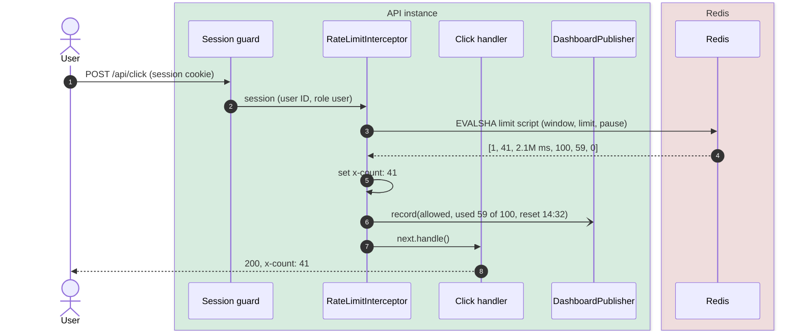
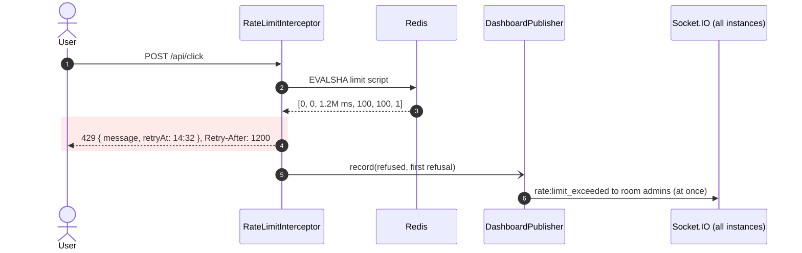
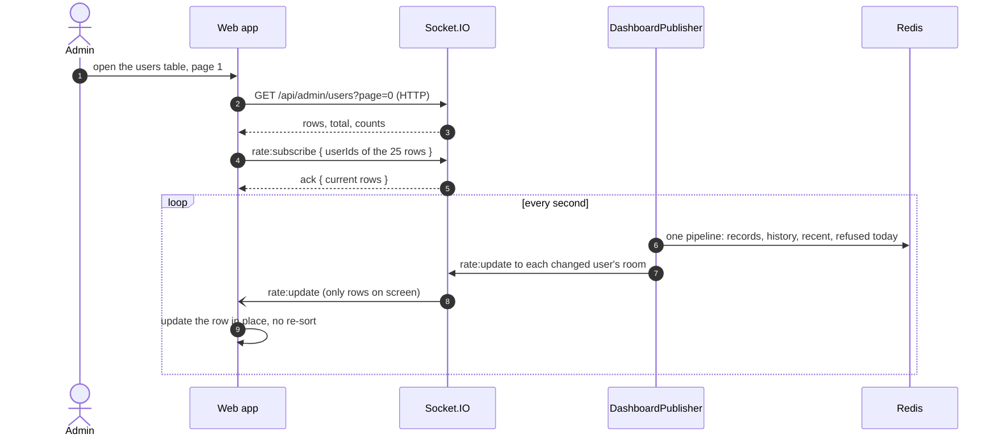

**Status:** Agreed · **Issue:** [#45](https://github.com/nitzanto/ratewatch/issues/45) · **Implements:** [Rate limiting](../../features/rate-limiting/), [Live user table](../../features/live-user-table/), [User detail](../../features/user-detail/), [Admin controls](../../features/admin-controls/), [Search and filters](../../features/search-and-filters/), [Analytics](../../features/analytics/)

This document says exactly how ratewatch uses Redis: the keys, the scripts, the endpoints and the events. The [high-level design](../../architecture/hld/) shows where these parts sit. The decisions behind them are in [Rate-limit store and window](../../adrs/rate-limit-store/), [Failure mode](../../adrs/failure-mode/), [Realtime delivery](../../adrs/realtime-delivery/), [Dashboard data](../../adrs/dashboard-data/) and [Redis client](../../adrs/redis-client/).

## Goal and non-goals

**Goal:** enforce each user's limit exactly, on any number of API instances, with one Redis call per request; and show admins those numbers live, at any number of users.

**Non-goals:** limits per endpoint or plan; history older than 24 hours; Redis replicas and Sentinel (the deployment work); a local "refused until the reset time" cache (added only if the load test shows the need).

## Redis keys

Every key that belongs to one user carries the user ID in braces, so Redis Cluster keeps that user's keys on one shard. User IDs look like `user-3f9a1c2e`.

### Limiter keys

| Key               | Type   | Fields / value                                                 | Expiry                                 | Written by                   |
| ----------------- | ------ | -------------------------------------------------------------- | -------------------------------------- | ---------------------------- |
| `rl:{uid}:window` | hash   | `count`, `extra`, `notified` (the first refusal was announced) | 1 hour, set when the window opens      | Limit script, admin controls |
| `rl:{uid}:limit`  | string | The custom limit (1–1,000)                                     | None; removed when the admin clears it | Admin controls               |
| `rl:{uid}:pause`  | string | The pause end, in epoch ms                                     | When the pause ends                    | Admin controls               |
| `rl:undo:<token>` | string | A snapshot of one user's keys before an admin change, as JSON  | 10 seconds                             | Admin controls               |

### Dashboard keys

| Key                          | Type   | Fields / value                                                                              | Expiry                                         |
| ---------------------------- | ------ | ------------------------------------------------------------------------------------------- | ---------------------------------------------- |
| `user:{uid}`                 | hash   | The user record, indexed by the query engine (below)                                        | 24 hours after the last request                |
| `hist:{uid}`                 | hash   | `a:<minute>` and `r:<minute>`: accepted and refused requests in each minute (epoch minutes) | Each field 24 hours after it was first written |
| `recent:{uid}`               | list   | The last 50 requests: `{"at":<ms>,"allowed":true}`, newest first                            | 24 hours after the last request                |
| `stats:refused:<YYYY-MM-DD>` | string | Refused requests on that UTC day                                                            | `EXPIREAT` the end of the next UTC day         |

### The user record

| Field         | Meaning                               | Index              | Expiry           |
| ------------- | ------------------------------------- | ------------------ | ---------------- |
| `id`          | User ID                               | `TAG SORTABLE`     | None             |
| `lastRequest` | Last request, epoch ms                | `NUMERIC SORTABLE` | None             |
| `baseLimit`   | The custom limit, or 100              | `NUMERIC`          | None             |
| `limit`       | `baseLimit` plus extra requests       | `NUMERIC SORTABLE` | At `resetAt`     |
| `used`        | Requests counted in the window        | `NUMERIC SORTABLE` | At `resetAt`     |
| `left`        | Requests left, never below 0          | `NUMERIC SORTABLE` | At `resetAt`     |
| `ratio`       | `used / limit`                        | `NUMERIC SORTABLE` | At `resetAt`     |
| `resetAt`     | Reset time, epoch ms                  | `NUMERIC SORTABLE` | At `resetAt`     |
| `windowEnd`   | Copy of `resetAt` that doesn't expire | None               | None             |
| `lastResetAt` | When the count last went back to zero | None               | None             |
| `pausedUntil` | Pause end, epoch ms                   | `NUMERIC`          | At `pausedUntil` |

The window's fields expire with the window (hash field expiry, Redis 7.4 and later), and `pausedUntil` with the pause. So a user whose window ended reads as a full limit with the OK status, and nothing has to clean up. The index:

```text
FT.CREATE users ON HASH PREFIX 1 user: SCHEMA
  id TAG SORTABLE  lastRequest NUMERIC SORTABLE  baseLimit NUMERIC
  limit NUMERIC SORTABLE  used NUMERIC SORTABLE  left NUMERIC SORTABLE
  ratio NUMERIC SORTABLE  resetAt NUMERIC SORTABLE  pausedUntil NUMERIC
```

The API creates the index at startup when `FT.INFO users` says it's missing.

## The limit check

### Where it runs

`RateLimitInterceptor` is a global interceptor (`APP_INTERCEPTOR`) in the API's rate-limit module. Interceptors run after guards, so the session guard has already checked the session. The interceptor skips:

- anything that isn't HTTP (`context.getType() !== 'http'`);
- routes marked `@Public()` (sign-in, sign-out, health), read with the same `isPublicKey` metadata as the guard;
- the Admin role.

It runs before `next.handle()`, so its order with the response serializer doesn't matter.

### The script

One Lua script, loaded with ioredis `defineCommand`, so it runs as `EVALSHA` and is resent as `EVAL` after Redis loses its script cache (restart or failover).

```lua
-- KEYS: window, limit, pause. ARGV: default limit, window length in ms.
local count = tonumber(redis.call('HGET', KEYS[1], 'count') or '0')
local extra = tonumber(redis.call('HGET', KEYS[1], 'extra') or '0')
local limit = tonumber(redis.call('GET', KEYS[2]) or ARGV[1]) + extra
local paused = redis.call('EXISTS', KEYS[3]) == 1

if count >= limit and not paused then
  -- Refused: write nothing except "announced", so the limit isn't used up.
  local first = redis.call('HSETNX', KEYS[1], 'notified', 1)
  return {0, 0, redis.call('PTTL', KEYS[1]), limit, count, first}
end

count = redis.call('HINCRBY', KEYS[1], 'count', 1)
if count == 1 then
  redis.call('PEXPIRE', KEYS[1], ARGV[2])
end
return {1, math.max(limit - count, 0), redis.call('PTTL', KEYS[1]), limit, count, 0}
```

It returns `[allowed, requestsLeft, msUntilReset, limit, count, firstRefusal]`. The API turns `msUntilReset` into the reset time with its own clock; API clocks are kept in sync by NTP, so the error is milliseconds.

- **Refused requests don't count:** the refused branch writes only `notified`, never `count`.
- **The expiry is set once,** when `count` becomes 1. Setting it on every request would push the reset time back forever.
- **Pause:** a paused user's requests are counted but never refused. `x-count` is 0 once they pass their limit.
- **What the script avoids,** because the unit-test mock gets it wrong: `HMGET` (arrays come back 0-based to Lua), `cjson`, and `TIME`.

### Responses

| Outcome      | Response                                                                                                                                                                                                           |
| ------------ | ------------------------------------------------------------------------------------------------------------------------------------------------------------------------------------------------------------------ |
| Allowed      | The handler runs. `x-count: <requests left>` is set before it runs.                                                                                                                                                |
| Refused      | `429`, body from the shared contract `rateLimitedResponseSchema`: `{ "message": "You've used all 100 requests for this hour.", "retryAt": "<ISO time>" }`, plus `Retry-After` in seconds. The handler doesn't run. |
| Redis failed | The handler runs without `x-count`. See [Failing open](#failing-open).                                                                                                                                             |

Every decision, allowed or refused, is handed to the dashboard publisher in memory (`DashboardPublisher.record(decision)`): no I/O on the request path.

### Flows

**A limited request.**



**A refused request.**



## Failing open

The Redis client fails fast, so a Redis outage costs at most about 50 ms per request:

| ioredis option         | Value     | Why                                                                     |
| ---------------------- | --------- | ----------------------------------------------------------------------- |
| `enableOfflineQueue`   | `false`   | Commands fail at once while disconnected, instead of waiting in a queue |
| `maxRetriesPerRequest` | `0`       | No retries on the request path                                          |
| `commandTimeout`       | `50` ms   | Bounds the wait for a reply; the load test sets the final value         |
| `connectTimeout`       | `2000` ms | Reconnects in the background with the default backoff                   |

On any error the interceptor lets the request through without `x-count`, and adds 1 to a failed-open counter. A logger writes one line at most every 10 seconds with the error and the count since the last line. `GET /api/health/ready` (public) answers 503 while the client's status isn't `ready`; `GET /api/health` stays the liveness check. The web app already shows "Limit unavailable" when `x-count` is missing.

While Redis is down the dashboard publisher keeps the latest numbers in memory (at most 100,000 users, oldest dropped first) and writes them when Redis is back. Events between instances stop, because the Socket.IO adapter uses Redis too; each instance still serves its own admins.

## Dashboard data

### Writing: once per second

`DashboardPublisher` keeps, per user changed since the last tick: the latest decision, accepted and refused counts per minute, and up to 50 new requests. Every second it sends one pipeline:

- `EVALSHA` the record script for each user (below);
- `HINCRBY hist:{uid} a:<minute> n`, and `r:` the same, then `HEXPIRE hist:{uid} 86400 NX FIELDS …`;
- `LPUSH recent:{uid} …`, `LTRIM recent:{uid} 0 49`, `EXPIRE recent:{uid} 86400`;
- `INCRBY stats:refused:<today> n` and `EXPIREAT` the end of tomorrow (UTC).

**The record script** writes one user record, and only when the numbers are newer: a later window, or the same window with a higher `used`. Two instances can flush the same user in either order, and the older batch never wins. It ignores a window that opened before `lastResetAt`, so a batch from before an admin's reset can't bring the old count back. When a later window opens, it sets `lastResetAt` to the old `windowEnd`. It then sets `HPEXPIREAT` on the window's fields at `resetAt` and `EXPIRE user:{uid} 86400`.

### Reading: the users table

`GET /api/admin/users`, Admin only:

| Parameter      | Values                                             | Default       |
| -------------- | -------------------------------------------------- | ------------- |
| `q`            | Full user ID, or a prefix of at least 2 characters | none          |
| `status`       | `ok`, `warning`, `exceeded`, `paused`              | all           |
| `activeWithin` | `15m`, `1h`, `24h`                                 | `24h`         |
| `sort`         | `id`, `left`, `resetAt`, `ratio`, `lastRequest`    | `lastRequest` |
| `order`        | `asc`, `desc`                                      | `desc`        |
| `page`         | 0, 1, 2…                                           | 0             |
| `pageSize`     | 25, 50, 100                                        | 25            |

It answers `{ rows, total, counts: { ok, warning, exceeded, paused } }`. One `FT.SEARCH` gets the page and `total`; four `FT.SEARCH … LIMIT 0 0` get the counts, each with the same search and last-active filters, so each chip's count matches what that filter would show. Status filters, with `P = @pausedUntil:[-inf +inf]`:

| Status   | Query                   |
| -------- | ----------------------- |
| Paused   | `P`                     |
| Exceeded | `-P @ratio:[1 +inf]`    |
| Warning  | `-P @ratio:[0.9 (1]`    |
| OK       | `-P -@ratio:[0.9 +inf]` |

A user whose window ended has no `ratio`, `left` or `resetAt`, so they count as OK and sort after users with an open window. The API derives each row's status the same way, and shows a full limit and no reset time for an ended window.

### Reading: user detail and analytics

| Endpoint                                      | Answers                                                                                                              | From                               |
| --------------------------------------------- | -------------------------------------------------------------------------------------------------------------------- | ---------------------------------- |
| `GET /api/admin/users/:id`                    | The row, `lastResetAt`, and the last 50 requests                                                                     | `user:{uid}`, `recent:{uid}`       |
| `GET /api/admin/users/:id/history?range=hour` | 60 one-minute buckets, accepted and refused                                                                          | `hist:{uid}`                       |
| `GET /api/admin/users/:id/history?range=day`  | 96 fifteen-minute buckets                                                                                            | `hist:{uid}`                       |
| `GET /api/admin/summary`                      | Total users (active in 24 hours), share near the limit (Warning ÷ total), refused today (UTC), top 5 users by `used` | The index, `stats:refused:<today>` |

## Realtime

`RealtimeGateway` uses `@nestjs/websockets` with Socket.IO on `/socket.io`, and the sharded Redis adapter (`@socket.io/redis-adapter`, `createShardedAdapter`) on a duplicate of the ioredis client.

- **Handshake:** the gateway reads the `session` cookie from the handshake headers, checks its signature with `SESSION_SECRET` and its expiry, and refuses anyone but the Admin.
- **Rooms:** every admin joins `admins`. The web app sends `rate:subscribe` with the user IDs on screen plus the open user (at most 101). The server leaves the old `user:<id>` rooms, joins the new ones, and acknowledges with the current rows, so nothing changes unseen between the page load and the subscription.

| Event                 | Direction      | Room                 | When                                                                       | Payload                                                                                                |
| --------------------- | -------------- | -------------------- | -------------------------------------------------------------------------- | ------------------------------------------------------------------------------------------------------ |
| `rate:subscribe`      | web → API, ack | none                 | The page or open user changes, and on reconnect                            | `{ userIds: string[] }` → ack `{ rows: UserRow[] }`                                                    |
| `rate:update`         | API → web      | `user:<id>`          | At most once per second per user per instance, volatile                    | `{ row: UserRow, requests: { at, allowed }[] }`: the latest row and the requests since the last update |
| `rate:limit_exceeded` | API → web      | `admins`             | At once, the first refusal in each window (`firstRefusal` from the script) | `{ userId, limit, resetAt, at }`                                                                       |
| `rate:summary`        | API → web      | `admins`, local only | Once per second, by each instance that has admins connected                | `{ totalUsers, nearLimitShare, refusedToday, counts, topUsers }`                                       |

`UserRow` is `{ userId, limit, requestsLeft, resetAt | null, status, lastRequestAt, pausedUntil | null }`. Every payload is a schema in `libs/contracts`.

**Live update flow.**



**The web app:**

- Rows update in place in the TanStack Query cache, without re-sorting. A row whose new value would move it shows the "order changed" hint; refreshing the page refetches.
- It keeps an update only when it's newer than the row it has: a later `resetAt`, or the same `resetAt` with a higher `used`.
- On reconnect it refetches the page, then sends `rate:subscribe` again.

## Admin controls

All under `/api/admin/users/:id`, Admin only. Each change takes effect at once, updates the user record directly, and sends a `rate:update` without waiting for the next tick.

| Control        | Endpoint                                                    | Change in Redis                                                                                           | Refused when                                       |
| -------------- | ----------------------------------------------------------- | --------------------------------------------------------------------------------------------------------- | -------------------------------------------------- |
| Reset limit    | `POST …/reset`                                              | `DEL rl:{uid}:window`; the record's window fields are removed and `lastResetAt` set to now                | none                                               |
| Reset many     | `POST /api/admin/users/reset` `{ userIds }`                 | The same for each user, up to 100                                                                         | more than 100 IDs                                  |
| Custom limit   | `PUT …/limit` `{ limit }` / `DELETE …/limit`                | `SET rl:{uid}:limit` / `DEL`                                                                              | `limit` outside 1–1,000                            |
| Extra requests | `POST …/extra-requests` `{ amount: 10 }`                    | `HINCRBY rl:{uid}:window extra 10`, in a script that checks the window exists and the limit stays ≤ 1,000 | no open window (409); limit would pass 1,000 (422) |
| Pause          | `PUT …/pause` `{ duration: "15m" \| "1h" \| "untilReset" }` | `SET rl:{uid}:pause <end> PX <ms>`; `untilReset` uses the window's `PTTL`                                 | `untilReset` with no open window (409)             |
| Unlock         | `DELETE …/pause`                                            | `DEL rl:{uid}:pause`                                                                                      | none                                               |

**Undo.** Each control answers with an `undoToken`. Before changing anything, it stores a snapshot of the user's three limiter keys (values and absolute expiry times) at `rl:undo:<token>` for 10 seconds. `POST /api/admin/undo/:token` restores them in one script, and puts each expiry back with `PEXPIREAT`, so the restored window ends when it would have. Requests the user made between the change and the undo are lost with the undo; it's at most 10 seconds.

## Local environment and CI

- **Compose:** a `redis` service on the `redis:8` image (pinned to a minor version), `--maxmemory-policy noeviction`, not published to the host. Production Compose adds a password, carried in `REDIS_URL`.
- **Never evict:** with `noeviction`, a full Redis refuses writes (the limiter fails open) instead of silently deleting a custom limit or a pause.
- **CI:** the concurrency and dashboard integration tests start Redis with `@testcontainers/redis` on the same image. The end-to-end job adds a `redis` service container.
- **Isolation:** every integration test signs in fresh random user IDs, so tests never share keys and nothing needs flushing.

## Edge cases

| Case                                                | What happens                                                                                   |
| --------------------------------------------------- | ---------------------------------------------------------------------------------------------- |
| 150 simultaneous requests for one user              | Exactly 100 succeed; the script runs them one at a time                                        |
| The window expires between two requests             | The next request finds no window and opens a new one                                           |
| A custom limit below what the user already used     | The next request is refused; requests left shows 0                                             |
| A custom limit raised mid-window                    | Applies on the next request                                                                    |
| A pause ends while the user is over their limit     | The next request is refused, with the window's reset time                                      |
| Redis restarts or fails over                        | The script cache is empty; ioredis resends the script. A failover can lose the last increments |
| Two instances flush the same user in reverse order  | The record script keeps the newer numbers                                                      |
| A batch from before an admin reset arrives after it | Ignored: its window opened before `lastResetAt`                                                |
| An admin sends requests                             | Never counted, never recorded                                                                  |

## Testing

| Level                       | What                                                                                                                                             | With                                                  |
| --------------------------- | ------------------------------------------------------------------------------------------------------------------------------------------------ | ----------------------------------------------------- |
| Unit: the interceptor       | The window, refused requests not counting, custom limit, extra requests, pause, failing open on an error and a timeout, skipped routes and Admin | ioredis-mock, Vitest fake timers                      |
| API over HTTP               | `x-count` going down, the 429 body, public and admin routes not counted, admin endpoints answering 403 to Users                                  | The full app, Redis provider swapped for ioredis-mock |
| Integration: concurrency    | 150 simultaneous requests for one user, exactly 100 succeed                                                                                      | Testcontainers Redis                                  |
| Integration: dashboard data | The record script's ordering, field expiry, each status filter, sorting and paging, the summary                                                  | Testcontainers Redis 8                                |
| API: realtime               | Admin-only handshake, `rate:subscribe`, throttled `rate:update`, `rate:limit_exceeded` once per window                                           | Socket.IO client                                      |
| Web                         | "Limit unavailable"; rows updating in place; filters, counts and paging                                                                          | The app render helper with MSW                        |
| End-to-end                  | A User clicks and sees requests left fall; an Admin sees that row change live                                                                    | Playwright `web`                                      |

ioredis-mock has no query engine, so everything that reads the index is tested against a real Redis.

## Open questions

These are checked before #45 closes. Any surprise updates this document:

- ioredis-mock runs the limit script, through `defineCommand`, with the results above.
- MSW can mock the Socket.IO connection for web component tests.
- On Redis 8: `HPEXPIREAT` works inside the record script; numeric queries skip expired fields; a TAG prefix query matches IDs with `-` when escaped; documents without a sort field sort after the rest.
