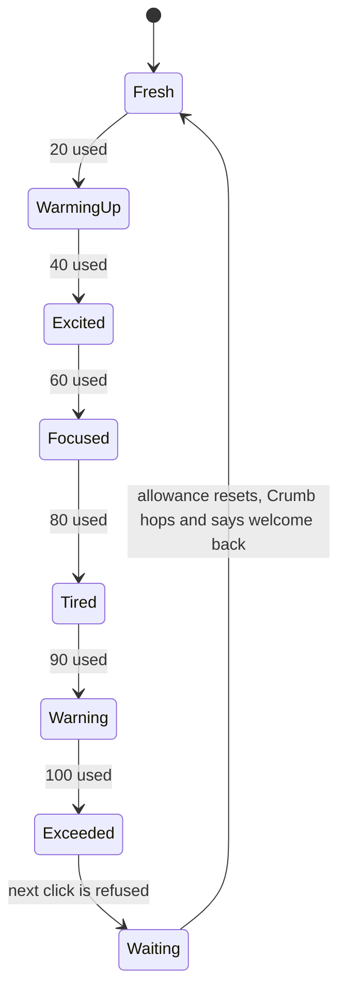

ratewatch has two kinds of screen. The **admin dashboard** is a working tool people keep open for hours, so it stays calm, dense and familiar, and spends colour only on actions, selection and status. The **cookie clicker** is where the product has fun: Crumb, a chocolate-chip cookie, shows a user how much of their hourly allowance is left.

## Palette: Harbor

A deep navy shell, a cool grey page, white surfaces and one cobalt accent. Navy sits opposite Crumb's dough on the colour wheel, so he stands out in the app bar.

| Role           | Colour    | Used for                                                                   |
| -------------- | --------- | -------------------------------------------------------------------------- |
| Shell          | `#0B1F33` | App bar, the sign-in welcome panel, snackbars                              |
| Page           | `#F4F6F9` | Page background                                                            |
| Surface        | `#FFFFFF` | Cards, tables, drawers, forms (with a `#E2E7ED` border)                    |
| Text           | `#0F1A24` | Content                                                                    |
| Secondary text | `#52606D` | Supporting copy, captions                                                  |
| Accent         | `#1F5BD8` | Primary buttons, selected filters, links, the selected row, the focus ring |
| OK             | `#0E7C66` | Under 90% of the allowance used                                            |
| Warning        | `#F5B83D` | 90% or more used (icons and borders use the darker `#9A5B00`)              |
| Exceeded       | `#8E1B3A` | 100% used                                                                  |
| Paused         | `#52606D` | Throttling paused by an admin                                              |

The three statuses differ in lightness as well as hue, so they stay distinct for people with colour blindness, and every status always comes with an icon and a word. All text meets WCAG AA contrast (4.5:1).

## Typography

One typeface, **IBM Plex Sans**, in regular, medium and semibold. Headings are semibold. Numbers in tables, counters and timers use fixed-width digits so columns line up and countdowns don't jitter. Buttons and tabs use sentence case.

## Layout

- **App shell:** a 64px navy bar with the Crumb logo, the Dashboard and Cookie clicker tabs, and one connection pill ("Live · API OK", "Reconnecting", "API unreachable").
- **Dashboard:** four summary cards, then the users table beside the status breakdown and top users. Opening a user slides a drawer in from the right with their history and the admin controls.
- **Cookie clicker:** one centred card with Crumb, the requests-left count, a usage bar and a message area of fixed height.
- **Sign in:** navy welcome panel with Crumb waving on the left, the form on the right. On phones the halves stack.

## Behaviour rules

- **Nothing moves under the pointer.** Live updates change numbers in place. The table re-sorts only when the pointer is off it and no user is open. Selecting rows swaps the filter row for a same-height selection bar. Messages on the clicker appear in a reserved slot.
- **Every admin action can be undone** for 10 seconds from the snackbar. Pausing throttling always has an end time. Lowering a limit below what the user already used warns first.
- **The limit is never a surprise.** The count updates after every click; a refusal says why and shows the time the user can try again.

## Crumb

Crumb's face and chocolate chips follow the user's status, so they can read where they stand at a glance.

### While OK: one chip every 20 requests

| Fresh                                                  | Warming up                                                       | Excited                                                    | Focused                                                    | Tired                                                  |
| ------------------------------------------------------ | ---------------------------------------------------------------- | ---------------------------------------------------------- | ---------------------------------------------------------- | ------------------------------------------------------ |
|  |  |  |  |  |
| 0–19 used, 5 chips                                     | 20–39, 4 chips                                                   | 40–59, 3 chips                                             | 60–79, 2 chips                                             | 80–89, 1 chip                                          |

Each time a chip drops, a short note explains it, so the chips double as a rough gauge of what's left.

### Warning and Exceeded

| Warning                                                                            | Exceeded                                                 |
| ---------------------------------------------------------------------------------- | -------------------------------------------------------- |
|                               |   |
| 90% or more used: wide eyes, a sweat drop, one chip, a nervous jitter now and then | 100% used: a bite out of him, no chips, crossed-out eyes |

### Motion

- **Idle:** a gentle bob while OK (slower when tired), a nervous jitter in short bursts at Warning, a slow slump at Exceeded.
- **Click:** Crumb squashes and springs back in a quarter of a second, and a "−1" floats up. The request is sent on the click itself, never after the animation.
- **Waiting out the limit:** a teal ring fills around Crumb while the bite grows back; halfway through, his eyes close to rest. When the allowance resets he hops and a "Welcome back" note appears.
- **Reduced motion:** with the system's reduce-motion setting on, none of this animates. His face still changes with status, and the count is still announced to screen readers.

### Sizes

36px in the app bar, 72px in empty states, 248px as the clicker button. Below 48px his face strokes get thicker so it still reads.

## Where things live

- Crumb artwork (SVG): `apps/docs/public/design/crumb/`.
- Interactive prototypes of every screen: `docs/design/prototypes/`.
- The theme in code: `apps/web/src/libs/theme/`.
